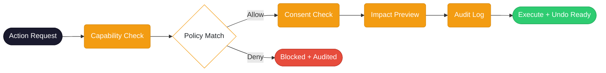
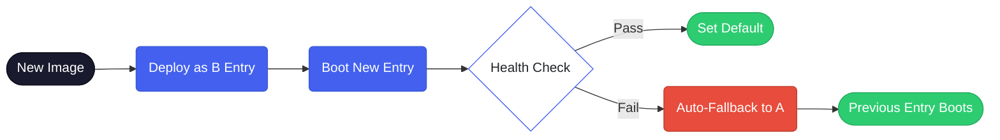

# AntOS - Features & Capabilities

> **AntOS** - the **AI-Native Transport Operating System**
>
> A modern, local-first, secure operating environment that understands user intent, transports trusted context across system boundaries, reasons about system state, automates approved actions, explains decisions, and recovers safely when something goes wrong.

**Version:** 1.0.0 (product) | Fedora 41 base | Kernel 6.17.8
**Release gate:** v1.2.0 (Phases 0-20 passed) + Phase 21 (ARM64/SFF) passed
**Architecture:** x86_64 (primary), aarch64 (validated in QEMU)

---

## At a Glance

| Category | What AntOS Provides |
|---|---|
| **AI-Native** | Intelligence is a system-level capability, not a bolted-on chatbot |
| **Local-First** | Core OS functions work fully offline; cloud AI is optional |
| **Atomic** | Image-based updates with A/B rollback via rpm-ostree |
| **Secure** | SELinux enforcing, Secure Action Gateway, least-privilege by design |
| **Wayland-Native** | Custom Smithay compositor in Rust; no X11 dependency |
| **Modular** | Contract-driven modules with versioned interfaces |
| **Reversible** | Every meaningful change has a rollback path |
| **Observable** | Every privileged action, AI decision, and state change is logged |
| **Multi-Arch** | x86_64 and aarch64 build pipelines with QEMU validation |

---

## 1. Core Design Principles (12)

These principles are binding on every implementation decision.

| ID | Principle | What It Means in Practice |
|---|---|---|
| P1 | **Local First** | Diagnostics, search, monitoring, settings, automations, and basic assistant work without Internet. Cloud AI is optional. |
| P2 | **AI Is a System Capability** | AI is accessible throughout the shell and services via standard interfaces - not just a chat window. |
| P3 | **Intent Over Navigation** | Users state objectives ("Prefer Ethernet when available") instead of clicking through settings pages. |
| P4 | **Explainability** | Users can ask "Why is this enabled?", "What changed since yesterday?", "Why did the network disconnect?" |
| P5 | **Reversibility** | Important changes support preview, snapshot, rollback, undo, or recovery wherever possible. |
| P6 | **Least Privilege** | Applications, agents, automations, and AI tools receive only the minimum permissions required. |
| P7 | **User Authority** | AI may recommend strongly, but the user controls policy. Autonomy is explicit and configurable. |
| P8 | **Modular Architecture** | No feature requires all of AntOS to be rebuilt or understood at once. |
| P9 | **Observability by Design** | Every privileged action, automation, AI decision, failure, and service transition produces structured logs. |
| P10 | **Graceful Degradation** | If AI is down, the OS still works. If cloud is down, local functions remain. If a nonessential module crashes, the shell survives. |
| P11 | **Beautiful but Functional UI** | Visual effects support hierarchy and comprehension - never decoration that harms readability. |
| P12 | **Hardware-Aware Intelligence** | AntOS understands CPU, GPU, RAM, NPU, storage, battery, thermals, network, and model capacity. |

---

## 2. The Five Transport Planes

AntOS treats the OS as a **trusted transport fabric for intelligence**. Every flow between user, AI, and OS passes through defined, observable interfaces.

| Plane | Direction | What It Carries |
|---|---|---|
| Intent Transport | User -> System | Natural-language goals -> structured system requests |
| Context Transport | System -> AI/Apps | Minimum authorized context required for reasoning |
| Event Transport | System -> Intelligence | Structured kernel/service/device events |
| Action Transport | Intelligence -> OS | Authorized actions through the Secure Action Gateway |
| Knowledge Transport | Bidirectional | Search, timeline, semantic relationships, explanations |

---

## 3. System Architecture

```mermaid
%%{init: {"flowchart": {"useMaxWidth": true}}}%%
flowchart TD
    classDef shellLayer fill:#7209b7,stroke:#560bad,color:#fff
    classDef uxLayer fill:#b5179e,stroke:#9b1160,color:#fff
    classDef aiLayer fill:#00b4d8,stroke:#0096c7,color:#fff
    classDef gatewayLayer fill:#f39c12,stroke:#d68910,color:#fff
    classDef servicesLayer fill:#2ecc71,stroke:#27ae60,color:#fff
    classDef sandboxLayer fill:#95a5a6,stroke:#7f8c8d,color:#fff
    classDef osLayer fill:#4361ee,stroke:#3a56d4,color:#fff
    classDef atomicLayer fill:#e74c3c,stroke:#c0392b,color:#fff
    classDef kernelLayer fill:#1a1a2e,stroke:#0f0f1e,color:#fff

    subgraph S1["AntOS Shell"]
        S["Desktop - Workspaces - Command Center - Panels - Notifications"]
    end
    subgraph S2["User Experience Services"]
        U["Search - Timeline - Clipboard - Settings - Files - Accessibility"]
    end
    subgraph S3["System Intelligence Layer"]
        A["Context - AI Router - Reasoning - Agents - Predictions - RCA"]
    end
    subgraph S4["Secure Action Gateway"]
        G["Capability - Policy - Consent - Impact - Audit - Undo"]
    end
    subgraph S5["AntOS Core Services"]
        C["Health - Security - Network - Devices - Automation - Knowledge"]
    end
    subgraph S6["Application / Agent Sandbox"]
        X["Flatpak - Portals - Rootless Containers - Agent Capabilities"]
    end
    subgraph S7["OS Services"]
        O["systemd - NetworkManager - PipeWire - BlueZ - D-Bus"]
    end
    subgraph S8["Atomic / Image-Based OS"]
        T["Updates - Deployments - Recovery - Btrfs - Boot"]
    end
    subgraph S9["Linux Kernel"]
        K["CPU - Memory - GPU - Storage - Network - USB - Input"]
    end

    S --> U --> A --> G --> C --> X --> O --> T --> K
    class S shellLayer
    class U uxLayer
    class A aiLayer
    class G gatewayLayer
    class C servicesLayer
    class X sandboxLayer
    class O osLayer
    class T atomicLayer
    class K kernelLayer
```

The stack is strictly layered - each layer may only depend on layers below it. The Secure Action Gateway is the **only** path from the intelligence layer to privileged OS services.

---

## 4. Desktop & Shell

### 4.1 Wayland Compositor

| Feature | Detail |
|---|---|
| Library | Smithay 0.7 (Rust) - chosen for memory safety and composability (ADR-0004) |
| Language | Rust 2021 edition (min 1.80.1) |
| Protocols | `wl_compositor`, `wl_shm`, `xdg_wm_base`, `wl_output`, `wl_seat` |
| Input | Keyboard and pointer via `wl_seat` |
| Multi-display | Two synthetic outputs (`antos-0`, `antos-1`) in headless mode; real DRM output when available |
| DRM/GBM | Opens `/dev/dri/card0`, creates `DrmSurface` + `GbmDevice` + `GbmAllocator` + `PixmanRenderer` |
| Renderer | Pixman (CPU rendering) with DMA-BUF format negotiation; falls back to `Xrgb8888` linear |
| Headless fallback | Preserved for non-DRM environments (e.g., QEMU without GPU) |
| Session | systemd user session (`antos-wayland-session.target`); lingering enabled for boot-without-login |

### 4.2 Shell UI

| Feature | Detail |
|---|---|
| Toolkit | Qt/QML with Rust bindings (ADR-0003) |
| Design system | 15+ reusable components: `Card`, `KpiCard`, `StatusChip`, `ListItem`, `SearchField`, `SwitchToggle`, `IconButton`, `Badge`, `AppLauncherTile`, `ToolLauncher`, `NotificationItem`, `CommandOutput`, `SmartSuggestion`, `RailButton`, `TopBar` |
| States | default, hover, focus, active, disabled, loading, error, empty, offline |
| Binary | `antos-shell-ui` (auto-starts in systemd user session) |

### 4.3 Shell API (D-Bus)

| Interface | `org.antos.Shell1` |
|---|---|
| Methods | `Ping`, `GetSessionState`, `RaiseError` |
| Signals | `StateChanged` |
| Properties | `SessionState` |
| Clients | `antos-session-status`, `antos-test-error`, `antos-watch-state`, `antos-shell-property` |

---

## 5. Secure Action Gateway

The **only path** from intelligence and automation to privileged OS actions.

### Six enforcement gates

| Gate | What It Checks |
|---|---|
| Capability | What action is being requested |
| Policy | allow / deny / prompt per `default-policy.json` |
| Consent | User confirmation for high-risk actions |
| Impact | Preview of what will change |
| Audit | Structured log of every decision |
| Undo | Reversibility where technically possible |

### Risk classification

| Risk | Behavior | Example |
|---|---|---|
| R0 | Trivial - auto-allow | `org.antos.Shell1.Ping` |
| R1-R3 | Low to medium - contextual | Varies by capability |
| R4 | High - prompt user | `org.antos.capability.install.update` |
| R5 | Destructive - deny by default | `org.antos.capability.format.disk` |

### Components

- `antos-policyd` - policy daemon exposing `org.antos.Policy1` on D-Bus
- `antos-policy-gateway` - gateway service
- `contracts/capabilities/policy-schema.json` - JSON Schema for policy rules
- `contracts/capabilities/default-policy.json` - default rules with risk classes

---

## 6. Intelligence Layer

| Feature | Detail |
|---|---|
| D-Bus interface | `org.antos.Intelligence1` |
| Provider abstraction | Pluggable provider manifest (`intelligence/providers/manifest.json`) |
| First provider | Ollama (local, offline) |
| Cloud AI | Optional; not a hard dependency for any core OS function (P1, P10) |
| Policy enforcement | `CanUseProvider` gate - checks whether a provider may be used (Phase 8) |
| Privacy gateway | No AI access to raw sensitive events without authorization |
| Client | `antos-list-providers` CLI |

### What makes AntOS AI "native"

- AI is accessible via D-Bus interfaces, not just a chat window (P2)
- AI consumes structured OS context through approved APIs - no screen scraping or shell access (P6)
- AI-driven actions pass through the Secure Action Gateway like any other caller (P6, P9)
- Every AI decision is explainable, auditable, and reversible where possible (P4, P5, P9)
- If AI is unavailable, the OS remains fully usable (P10)

---

## 7. Core Services Catalog

15 services implemented and gate-verified across Phases 5-20.

| Service | Phase | D-Bus / Interface | Client Binary | What It Does |
|---|---|---|---|---|
| Secure Action Gateway | 5 | `org.antos.Policy1` | `antos-policyd`, `antos-policy-gateway` | Enforces capability/policy/consent on all privileged actions |
| Command Center | 6 | `org.antos.CommandCenter1` | `antos-search` | System-wide search with indexed results; no UI freeze |
| Intelligence | 7, 8 | `org.antos.Intelligence1` | `antos-list-providers` | AI provider abstraction with policy enforcement |
| Health / Sysinfo | 9 | systemd timer | `antos-sysinfo` | System health monitoring with structured telemetry |
| Automation | 10 | whitelist executor | `antos-run-command` | Whitelisted command execution through the gateway |
| Knowledge | 11 | notes API | `antos-note`, `antos-list-notes`, `antos-delete-notes` | Local, deletable notes/knowledge base with privacy controls |
| Security Guardian | 12 | capability API | `antos-capability`, `antos-security-status` | Capability manifests and security status reporting |
| Developer | 13 | build info | `antos-build-info` | Build metadata query |
| Installer / Rollback | 14 | rollback status | `antos-rollback-status` | Deployment rollback status reporting |
| Beta / Service Status | 15 | service status | `antos-service-status` | Systemd service health aggregation |
| Interaction | 16 | input status | `antos-input-status` | Input device status and accessibility |
| Connectivity | 17 | network status | `antos-network-status` | Network state reporting |
| Security / Privacy | 18 | security status | `antos-security-status` | Security and privacy posture |
| Productivity | 19 | focus | `antos-focus` | Focus / workspace management |
| Advanced / Features | 20 | feature flags | `antos-feature` | Feature flag system with local overrides |
| Hardware Profile | 21 | profile detection | `antos-hardware-profile` | Device-class detection and SFF tuning |

### Planned services (not yet implemented)

Event Bus, Context Engine, Timeline, Backup, Update Intelligence, Energy Management.

---

## 8. Atomic Updates & Rollback

| Feature | Detail |
|---|---|
| Technology | OSTree via rpm-ostree / bootc (ADR-0002) |
| Model | A/B boot entries - atomic, image-based deployments |
| Storage | Content-addressed, immutable trees in `/ostree/repo` |
| Health verification | Runs before a deployment is made default |
| Rollback | Boot-loader-owned - cannot be blocked by a running application |
| Read-only | Deployments are signed and read-only, reducing runtime tampering |
| Operator commands | `bootc status`, `bootc rollback` |
| Verification | `tooling/rollback/verify-rollback.sh`, `tooling/vm-runner/test-rollback.sh` |

### Three distinct concepts (do not confuse)

| Concept | What It Is | What It Is NOT |
|---|---|---|
| OS deployment rollback | rpm-ostree A/B boot entry switch | Not a backup |
| Btrfs snapshots | Efficient local filesystem state | Not a backup; not the primary rollback |
| User backups | Separate user-data backup | Not OS rollback |

---

## 9. Security

| Feature | Detail |
|---|---|
| MAC framework | SELinux enforcing (Fedora default; preferred by threat model per ADR-0001) |
| Secure Action Gateway | All privileged actions pass through 6-gate enforcement |
| Application isolation | Flatpak + portals for desktop apps |
| Containers | Podman, rootless by default |
| Agent capabilities | Least privilege per agent |
| Atomic updates | Signed, read-only deployment trees |
| Supply chain | Signing and reproducible builds enforced; risk inherited from Fedora mirrors |
| Threat model | 14 threat categories captured including malicious apps, compromised AI, prompt injection, supply-chain attacks, rollback attacks |
| Critical rule | External text must never be trusted as system instructions |
| UEFI trust (aarch64) | AAVMF must be packaged from a Fedora-signed source |

---

## 10. Installer & Recovery

| Feature | Detail |
|---|---|
| Installer framework | Anaconda addon (`com_antos_account`) with GUI spoke |
| First-boot wizard | `antos-first-boot.service` - interactively collects password on first boot if not pre-set |
| Disk partitioning | User-controlled partitioning and encryption |
| Recovery target | `antos-recovery.target` - dedicated systemd recovery mode |
| Recovery shell | `antos-recovery-shell.service` - serial console recovery shell enabled at boot |
| Migration | Migration intelligence with privacy scans |
| Support bundles | Support bundle generation for troubleshooting |
| Rollback test prep | `/usr/local/bin/antos-prepare-rollback-test` |

---

## 11. Build & Development Pipeline

| Feature | Detail |
|---|---|
| Build approach | Bootable container -> qcow2 disk image via bootc-image-builder |
| Base image | `quay.io/fedora/fedora-bootc:41` (multi-arch) |
| Builder | `quay.io/fedora/fedora:41` with Rust toolchain |
| Cargo caching | Dummy build downloads deps once; source changes only recompile local crate |
| Architectures | x86_64 (default), aarch64 (`--arch aarch64`) |
| QEMU validation | Every phase must boot and pass gates in QEMU before being marked passed |
| ISO build | `build-iso.sh --arch <arch>` produces installable ISO with AntOS branding |
| CI | `tooling/ci/antos-ci.sh` lints all scripts; GitHub Actions workflow |
| Cross-build | x86_64 -> aarch64 via qemu-user-static/binfmt (blocked on WSL; use native ARM host) |

### Build artifacts

| Artifact | Path |
|---|---|
| Container image | `docker.io/antos/image:phase0` (x86_64) / `:phase0-aarch64` |
| qcow2 disk | `build/antos-phase1.qcow2` / `build/antos-phase1-aarch64.qcow2` |
| SHA256 checksum | `build/antos-phase1.qcow2.sha256` |
| Image manifest | `build/image-manifest.json` |
| SSH key | `build/ssh/antos` (ed25519, throwaway) |
| ISO | via `build-iso.sh` |

---

## 12. Hardware Support

### Tiers

| Tier | Target | Status |
|---|---|---|
| Primary | x86_64 desktops/NUCs | Passed (v1.2.0) |
| ARM64 / SFF | Raspberry Pi or equivalent | QEMU validated (Phase 21); bare-metal deferred to Phase 22 |

### SFF tuning profile

When AntOS detects a small-form-factor device (via device-tree on ARM SBCs, DMI on x86_64 SFF/NUC, or `--sff` override), it applies:

| Setting | Value |
|---|---|
| Compositor refresh | 30 Hz |
| CPU governor | powersave |
| Swappiness | 60 |
| Disabled services | `antos-command-center`, `antos-intelligence-dbus` |
| Max memory hint | 4096 MB |
| Max CPU cores | 4 |

### Hardware profile detection

`antos-hardware-profile` detects device class and emits `/run/antos/hardware-profile.json`. Defaults to `standard` unless DMI/DT clearly reports `embedded` or `pico`.

---

## 13. Inter-Process Communication

| Transport | Use Case | ADR |
|---|---|---|
| D-Bus | Desktop/system integration, privileged service calls, Polkit, Flatpak portals | ADR-0005 |
| gRPC / typed channels | High-throughput service-to-service communication | ADR-0005 |
| AntOS Event Bus | Structured internal events with audit, replay, and timeline integration | ADR-0005 |

### D-Bus namespaces

All AntOS D-Bus interfaces live under `org.antos.*`:
- `org.antos.Shell1` - Shell API
- `org.antos.Policy1` - Secure Action Gateway
- `org.antos.CommandCenter1` - Search service
- `org.antos.Intelligence1` - AI provider service

---

## 14. Application Ecosystem

| Feature | Detail |
|---|---|
| Desktop apps | Flatpak + portals (sandboxed) |
| Containers | Podman rootless by default |
| Integrations | Flatpak, Podman, Ollama, smart-home, Zigbee, SSH, NAS |
| SDK | Rust, Python, and example integrations (`sdk/`) |
| Agent packages | Planned (ADR-0015) - agent package format with capability manifests |

---

## 15. Version & Release Management

| Field | Value | Source |
|---|---|---|
| Product version | 1.0.0 | `CurrentVesion.json` |
| OS name | AntOS | `CurrentVesion.json` |
| Build version | 1 | `CurrentVesion.json` |
| Fedora base | 41 | `Containerfile`, `os-release` |
| Kernel | 6.17.8-100.fc41.x86_64 | Fedora 41 bootc base |
| Latest gate | v1.2.0 (Phases 0-20) + Phase 21 | `BUILD_STATUS.md` |
| Build info | `/usr/share/antos/build-info.json` (label, version, commit, timestamp) | Containerfile |
| Query | `antos-build-info` | CLI client |

---

## 16. Phase Completion Record

All 21 phases passed with verified gates.

| Milestone | Phases | Status |
|---|---|---|
| v1.0 - Baseline | 0-15 | Passed |
| v1.1 - Release | 0-18 | Passed |
| v1.2 - Release | 0-20 | Passed |
| Phase 21 - ARM64/SFF | 21.1-21.4 | Passed |

### Phase summary

| Phase | Capability | Gate |
|---|---|---|
| 0 | Architecture & Toolchain | Reproducible minimal image boots in QEMU |
| 1 | Minimal AntOS Image | boot/reboot/shutdown stable, rollback works |
| 2 | Wayland Desktop Foundation | Usable graphical session (wl_compositor, xdg_wm_base, multi-display, input) |
| 3 | Design System & Core Shell | 15 reusable QML components, consistent styling |
| 4 | AntOS Core APIs | D-Bus contract tests pass (`org.antos.Shell1`) |
| 5 | Secure Action Gateway | AI/automation cannot bypass gateway |
| 6 | Command Center | Search works without AI, no UI freeze |
| 7 | Local AI Foundation | Provider removable, privacy gateway enforced |
| 8 | Explainable Intelligence | No fabricated telemetry, deterministic metadata first |
| 9 | Health / Infrastructure | Monitoring does not destabilize, predictions include evidence |
| 10 | Automation | All privileged actions pass gateway, NL compiles to schema |
| 11 | Smart Workspaces & Knowledge | Clear privacy controls, local and deletable |
| 12 | Security Guardian | Independent security review, capability manifests |
| 13 | Developer & Device Ecosystem | Integrations optional, container UI not in boot path |
| 14 | Installer & Recovery UX | Install/update/rollback/recovery/migration tested |
| 15 | Beta Hardening | No new architecture, all tests pass |
| 16 | Interaction & Accessibility | New input without breaking keyboard/mouse |
| 17 | Connectivity, Storage & Migration | P2P sync offline, migration preserves privacy |
| 18 | Security, Privacy & Trust | No false positives, AI safety enforced |
| 19 | Productivity, Ecosystem & Sustainability | Privacy-respecting, no AI training on secrets |
| 20 | Advanced / Futuristic | Feature flags, architecture/security/ethics review |
| 21 | ARM64 / Small Form Factor | Multi-arch build, aarch64 QEMU, SFF profile |

---

## 17. Technical Stack Summary

| Layer | Technology | Chosen By |
|---|---|---|
| Kernel | Linux 6.17.8 (Fedora 41) | ADR-0001 |
| Atomic updates | rpm-ostree / bootc / OSTree | ADR-0001, ADR-0002 |
| Init | systemd | Master spec |
| Display | Wayland | Master spec |
| Compositor | Smithay 0.7 (Rust) | ADR-0004 |
| Core language | Rust | Master spec |
| UI toolkit | Qt/QML + Rust bindings | ADR-0003 |
| AI tooling | Python (behind service contracts) | Master spec |
| App isolation | Flatpak + portals | Master spec |
| Containers | Podman (rootless) | Master spec |
| Filesystem | Btrfs | Master spec |
| Audio | PipeWire | Master spec |
| Network | NetworkManager | Master spec |
| Bluetooth | BlueZ | Master spec |
| IPC | D-Bus + gRPC + Event Bus | ADR-0005 |
| Logging | journald + AntOS event store | Master spec |
| AI runtime | Provider abstraction (Ollama first) | Master spec |
| Security | SELinux enforcing | ADR-0001 |
| Boot | UEFI | Master spec |
| Installer | Anaconda addon | Master spec |

---

## 18. What AntOS Does NOT Do (v1.x)

These are explicit non-goals, not limitations to be "fixed":

- Does not create a new kernel from scratch
- Does not create new GPU/Wi-Fi/USB/BT/NVMe/audio drivers when Linux drivers exist
- Does not replace Linux device support for branding
- Does not expose unrestricted root access to an LLM
- Does not depend on Internet connectivity for basic operation
- Does not depend on one proprietary model provider
- Does not attempt Windows API compatibility
- Does not build an entire software ecosystem before core OS stability
- Does not replace every Linux userspace component with custom code
- Does not run arbitrary downloaded AI agents with elevated privileges
- Does not implement invisible telemetry collection
- Does not automatically send system logs or personal files to cloud AI

---

## Cross-References

| Resource | Path |
|---|---|
| Master specification | `AntOS/AntOS_Master_AI_Build_Specification_FINAL.md` |
| Build status | `AntOS/BUILD_STATUS.md` |
| ADR index | `AntOS/docs/adr/README.md` |
| Threat model | `AntOS/docs/threat-models/initial-threat-model.md` |
| Coding standards | `AntOS/docs/coding-standards.md` |
| Document A - Architecture | `AntOS-Technical-Documentation-A-Architecture.md` |
| Document B - Build & Ops | `AntOS-Technical-Documentation-B-BuildOps.md` |
| Document C - Full Reference | `AntOS-Technical-Documentation-C-FullReference.md` |
