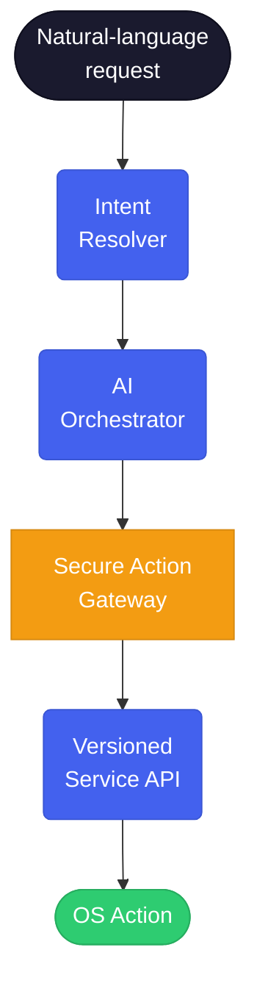
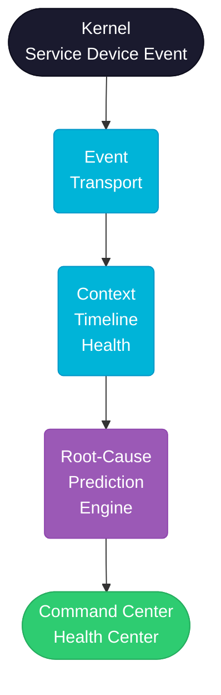

# AntOS Technical Documentation - A: Architecture

**Project:** AntOS - AI-Native Transport Operating System
**Document type:** Architecture Reference
**Source of truth:** `AntOS/AntOS_Master_AI_Build_Specification_FINAL.md`, `AntOS/docs/adr/`, `AntOS/MODULE.md`
**Generated:** 2026-08-25

---

## 1. Product Identity

**AntOS** = **(ANT)** _AI-Native Transport_ + **OS** _Operating System_

AntOS is a Linux-based, Wayland-native, atomic/rollback-capable operating environment that treats the OS as a **trusted transport fabric for intelligence**. It is not "Linux with a different wallpaper" - it is a modular, contract-driven, security-gated, test-first, reversible OS where user intent, trusted context, system events, knowledge, and authorized actions move through explicit, secure, observable transport layers.

### Short statements

| Audience | Statement |
|---|---|
| Product | "AntOS is an AI-Native Transport Operating System: a modern, local-first, secure operating environment designed to understand user intent, transport trusted context across system boundaries, reason about system state, automate approved actions, explain decisions, and recover safely when something goes wrong." |
| Marketing | "AntOS - Intelligence transported safely across your entire operating system." |
| Technical | "AntOS is a modular Linux-based AI-native operating environment built around secure intent transport, structured context, deterministic system APIs, local-first intelligence, policy-controlled automation, observability, and reversible system actions." |

### Naming policy

- The official product name is always written **AntOS**.
- Do not use `ANTOS`, `Ant OS`, `Ant-OS`, or legacy branding (uppercase allowed only in ASCII diagrams/technical constants).
- Internal component names: AntOS Core, AntOS Shell, AntOS Command Center, AntOS Health Center, AntOS Intelligence, AntOS Secure Action Gateway, AntOS Event Transport, AntOS Context Engine, AntOS Model Router, AntOS Automation Engine, AntOS Security Guardian, AntOS Infrastructure Center, AntOS Developer Center, AntOS Agent Center.
- Technical namespace: `antos-core-*`, `antos-shell-*`, `antos-ai-*`, `antos-agent-*`, `antos-platform-*`, `antos-service-*`.
- D-Bus namespace: `org.antos.*`.

---

## 2. Product Principles

All implementation decisions must support these principles.

| ID | Principle | Summary |
|---|---|---|
| P1 | Local First | Core intelligence, diagnostics, search, monitoring, settings, automations, and basic assistant functions work without Internet. Cloud AI is optional. |
| P2 | AI Is a System Capability, Not a Chatbot | AI is available throughout the shell and services via standard interfaces. The assistant is only one UI to the intelligence layer. |
| P3 | Intent Over Navigation | Users state objectives ("Prefer Ethernet when available") instead of navigating settings pages. |
| P4 | Explainability | Users can ask "Why is this enabled?", "Why did the network disconnect?", "What changed since yesterday?" |
| P5 | Reversibility | Important changes support preview, snapshot, rollback, undo, or recovery wherever possible. |
| P6 | Least Privilege | Applications, agents, automations, and AI tools receive the minimum permissions required. |
| P7 | User Authority | AI may recommend strongly, but the user controls policy. Autonomy must be explicit and configurable. |
| P8 | Modular Architecture | No feature may require all of AntOS to be rebuilt or understood at once. |
| P9 | Observability by Design | Every privileged action, automation, AI decision, failure, service state transition, and update produces structured logs/events. |
| P10 | Graceful Degradation | If AI is unavailable, AntOS still operates as a fully usable OS. If cloud is down, local functions remain usable. If a nonessential module crashes, the shell and core OS remain operational. |
| P11 | Beautiful but Functional UI | Visual effects support hierarchy and comprehension, not decoration that harms readability or performance. |
| P12 | Hardware-Aware Intelligence | AntOS understands available CPU, GPU, RAM, NPU, storage, battery, thermals, network devices, and model capacity. |

### Explicit non-goals (v1.x)

AntOS v1.x will NOT:
- create a new general-purpose kernel from scratch,
- create new GPU/Wi-Fi/USB/Bluetooth/NVMe/audio drivers when Linux drivers exist,
- replace Linux device support purely for branding,
- expose unrestricted root access to an LLM,
- depend on Internet connectivity for basic operation,
- depend on one proprietary model provider,
- attempt Windows API compatibility as an initial milestone,
- build an entire software ecosystem before core OS stability,
- replace every Linux userspace component with custom code,
- run arbitrary downloaded AI agents with elevated privileges,
- implement invisible telemetry collection,
- automatically send system logs or personal files to cloud AI.

---

## 3. The Five Transport Planes

"Transport" in AntOS does not mean only network transport. It describes the OS as a policy-controlled coordination and movement layer. Every meaningful flow between intelligence and the OS passes through defined, observable interfaces.

### 3.1 Intent Transport

Carries user goals into structured system requests.



### 3.2 Context Transport

Provides the minimum authorized context required by applications and AI.

### 3.3 Event Transport

Moves structured system, device, security, and infrastructure events.



### 3.4 Action Transport

Carries authorized actions through the Secure Action Gateway into deterministic services.

### 3.5 Knowledge Transport

Connects search, timeline, system state, semantic relationships, and explanations without bypassing privacy policy.

---

## 4. High-Level Architecture

```mermaid
%%{init: {"flowchart": {"useMaxWidth": true}}}%%
flowchart TD
    classDef shellLayer fill:#7209b7,stroke:#560bad,color:#fff
    classDef uxLayer fill:#b5179e,stroke:#9b1160,color:#fff
    classDef aiLayer fill:#00b4d8,stroke:#0096c7,color:#fff
    classDef gatewayLayer fill:#f39c12,stroke:#d68910,color:#fff
    classDef servicesLayer fill:#2ecc71,stroke:#27ae60,color:#fff
    classDef sandboxLayer fill:#95a5a6,stroke:#7f8c8d,color:#fff
    classDef osLayer fill:#4361ee,stroke:#3a56d4,color:#fff
    classDef atomicLayer fill:#e74c3c,stroke:#c0392b,color:#fff
    classDef kernelLayer fill:#1a1a2e,stroke:#0f0f1e,color:#fff

    subgraph S1["AntOS Shell"]
        S["Desktop<br/>Workspaces<br/>Command Center<br/>Panels<br/>Notifications"]
    end
    subgraph S2["User<br/>Experience<br/>Services"]
        U["Search<br/>Timeline<br/>Clipboard<br/>Settings Files<br/>Accessibility"]
    end
    subgraph S3["System<br/>Intelligence<br/>Layer"]
        A["Context AI<br/>Router<br/>Reasoning<br/>Agents<br/>Predictions<br/>RCA"]
    end
    subgraph S4["Secure Action<br/>Gateway"]
        G["Capability<br/>Policy Consent<br/>Impact Audit<br/>Undo"]
    end
    subgraph S5["AntOS Core<br/>Services"]
        C["Health<br/>Security<br/>Network<br/>Devices<br/>Automation<br/>Knowledge"]
    end
    subgraph S6["Application<br/>Agent Sandbox"]
        X["Flatpak<br/>Portals<br/>Rootless<br/>Containers<br/>Agent<br/>Capabilities"]
    end
    subgraph S7["OS Services"]
        O["systemd<br/>NetworkManager<br/>PipeWire BlueZ<br/>D-Bus"]
    end
    subgraph S8["Atomic<br/>Image-Based OS"]
        T["Updates<br/>Deployments<br/>Recovery Btrfs<br/>Boot"]
    end
    subgraph S9["Linux Kernel"]
        K["CPU Memory GPU<br/>Storage<br/>Network USB<br/>Input"]
    end

    S --> U --> A --> G --> C --> X --> O --> T --> K
    class S shellLayer
    class U uxLayer
    class A aiLayer
    class G gatewayLayer
    class C servicesLayer
    class X sandboxLayer
    class O osLayer
    class T atomicLayer
    class K kernelLayer
```



The stack is strictly layered: each layer may only depend on layers below it, never above. The Secure Action Gateway is the only path from the intelligence layer to privileged OS services.

---

## 5. Technical Foundation

| Layer | Choice | Source |
|---|---|---|
| Kernel | Upstream Linux via Fedora 41 (currently `6.17.8-100.fc41.x86_64`) | ADR-0001, master spec sec. 4 |
| System image | Atomic/image-based via `rpm-ostree` / bootc | ADR-0001, ADR-0002 |
| Init/service manager | systemd | master spec sec. 4 |
| Display protocol | Wayland | master spec sec. 4 |
| Compositor/shell | Custom AntOS Shell on Smithay (Rust) | ADR-0004 |
| Core language | Rust | master spec sec. 4, coding-standards |
| UI toolkit | Qt/QML with Rust bindings + AntOS design-system layer | ADR-0003 |
| AI experimentation | Python permitted behind stable service contracts | master spec sec. 4 |
| Desktop app isolation | Flatpak + portals | master spec sec. 4 |
| Containers | Podman, rootless by default | master spec sec. 4 |
| Filesystem | Btrfs where supported | master spec sec. 4 |
| Audio | PipeWire | master spec sec. 4 |
| Networking | NetworkManager | master spec sec. 4 |
| Bluetooth | BlueZ | master spec sec. 4 |
| IPC (primary) | D-Bus for desktop/system integration + versioned AntOS service APIs | ADR-0005 |
| IPC (high-throughput) | gRPC / typed channels for service-to-service | ADR-0005 |
| Structured internal events | AntOS Event Bus abstraction | ADR-0005 |
| Logging | journald + structured AntOS event store | master spec sec. 4 |
| Local model runtime | Provider abstraction, Ollama supported first | master spec sec. 4 |
| Security policy | SELinux (Fedora default; preferred by threat model) | ADR-0001 |
| Boot | UEFI; implementation via ADR | master spec sec. 4 |
| Installer | Separate installer module (Anaconda addon), not embedded in shell | master spec sec. 4, installer MODULE.md |
| Update strategy | Atomic update, health verification, automatic rollback | ADR-0002 |

### Important distinction (master spec sec. 4.1)

Do not confuse:
- **OS deployment rollback** (rpm-ostree A/B boot entries) - primary mechanism
- **Btrfs snapshots** - efficient local filesystem state, not backups
- **User backups** - separate concern

---

## 6. Repository Layout

```text
AntOS/
|-- AntOS_Master_AI_Build_Specification_FINAL.md  - authoritative architecture
|-- AntOS_Build_Execution_Guide.md  - step-by-step to v1.0
|-- AntOS_AI_Command_Template.md  - copy-paste build commands
|-- AntOS_Phase21_AI_Command_Template.md  - Phase 21 (ARM/SFF) commands
|-- BUILD_STATUS.md  - phase progress (single source of truth)
|-- CurrentVesion.json  - version metadata source of truth
|-- MODULE.md  - root module definition
|-- README.md, CONTRIBUTING.md, SECURITY.md
|
|-- docs/
|   |-- architecture/  - high-level structure, transport planes, repo layout
|   |-- adr/  - Architecture Decision Records (ADR-0001..0021)
|   |-- threat-models/  - initial + evolving threat models
|   |-- ux/  - UX research and design
|   |-- api/  - public API definitions (D-Bus XML)
|   |-- operations/  - build, release, rollback, phase plans
|   |-- design-system/  - UI design system reference
|   |-- coding-standards.md
|   `-- releases/  - release notes
|
|-- contracts/
|   |-- dbus/  - D-Bus interface contracts (org.antos.*)
|   |-- capabilities/  - capability policy schema + default policy
|   |-- events/  - event schema definitions
|   |-- protobuf-or-schema/  - gRPC/protobuf contracts
|   `-- versioning/  - requirement ID schema
|
|-- platform/
|   `-- image/
|       |-- Containerfile  - multi-stage bootable container build
|       |-- branding/  - icons, wallpapers, logos
|       `-- config/  - os-release, journald, recovery target, sudoers
|
|-- shell/
|   |-- compositor/  - Smithay-based Wayland compositor (Rust)
|   |-- api/  - Shell D-Bus API service
|   `-- ui/  - Qt/QML shell UI + design-system
|
|-- services/
|   |-- action-gateway/  - Secure Action Gateway (policyd + gateway)
|   |-- health/  - System health/sysinfo
|   |-- security/  - Security Guardian / capability
|   |-- devices/  - Hardware profile detection
|   |-- automation/  - Whitelisted command execution
|   |-- knowledge/  - Notes / knowledge base
|   |-- installer/  - Rollback status client
|   |-- beta/  - Service status
|   |-- interaction/  - Input status
|   |-- connectivity/  - Network status
|   |-- productivity/  - Focus
|   `-- advanced/  - Feature flags
|
|-- intelligence/
|   |-- Cargo.toml  - antos-intelligence-dbus
|   |-- providers/  - Provider manifest (Ollama first)
|   `-- client/  - antos-list-providers
|
|-- apps/
|   `-- command-center/  - Search index + D-Bus search service
|
|-- integrations/  - Flatpak, Podman, Ollama, smart-home, SSH, NAS
|-- installer/
|   |-- anaconda-addon/  - com_antos_account GUI spoke
|   `-- first-boot/  - antos-first-boot wizard + service
|-- sdk/  - Rust, Python, examples
|-- tests/  - unit, contract, integration, security, performance,
|                                accessibility, UI, QEMU, recovery
|-- tooling/
|   |-- image-builder/  - build.sh, bib-common.sh, build-iso.sh
|   |-- vm-runner/  - run-qemu.sh, phase gate scripts
|   |-- ci/  - antos-ci.sh
|   |-- dev/, release/, lint/
`-- releases/  - release artifacts, manifests, changelogs
```

Every major directory MUST contain a `MODULE.md` defining purpose, owned responsibilities, explicit non-responsibilities, public interfaces, consumed interfaces, events, privileges, data stored, privacy classification, failure behavior, security boundaries, tests, and definition of done. This rule prevents AI-generated architectural drift.

---

## 7. Architecture Decision Records (ADRs)

All irreversible or cross-cutting architecture choices are recorded as ADRs. Each ADR includes: Context, Decision, Alternatives Considered, Security Impact, Compatibility Impact, Migration Strategy, Consequences.

### Status values: Proposed -> Accepted -> Superseded / Rejected

### Accepted ADRs (0001-0005, 0021)

| ADR | Title | Status | Decision summary |
|---|---|---|---|
| ADR-0001 | AntOS base distribution | Accepted | **Fedora Silverblue / rpm-ostree** as base. Chosen for: atomic updates with rollback, maintained Wayland/PipeWire/systemd stack, SELinux default, toolchain alignment (rpm-ostree + podman + Flatpak). Ubuntu rejected because snap conflicts with the single-packaging-story rule. Debian rejected (no atomic by default). Arch rejected (maintenance burden). Fedora CoreOS/IoT rejected (server-only). |
| ADR-0002 | Atomic deployment technology | Accepted | **OSTree via rpm-ostree** for atomic, image-based deployments with A/B boot entries and health-verified activation. Btrfs snapshots alone rejected (not image-based). A/B raw partitions rejected (harder to manage). Package-manager snapshots rejected (partial-update risk). |
| ADR-0003 | Desktop toolkit | Accepted | **Qt/QML** as primary desktop toolkit with Rust bindings and AntOS design-system layer. GTK4 rejected (GNOME ecosystem conflict). Iced/Slint rejected (not mature for desktop). Dioxus rejected (web-based, not native Wayland). |
| ADR-0004 | Wayland compositor library | Accepted | **Smithay (Rust)** as compositor library, with wlroots fallback if Smithay lacks features. Mutter rejected (GNOME-tied). Weston rejected (reference only). Rust memory safety reduces compositor security bugs. |
| ADR-0005 | Primary IPC strategy | Accepted | **D-Bus** for desktop/system integration + **gRPC/typed channels** for high-throughput service-to-service + **AntOS Event Bus** abstraction for structured internal events. D-Bus-only rejected (scaling). gRPC-only rejected (desktop integration). Unix sockets rejected (re-implementing discovery/auth). |
| ADR-0021 | ARM64 / Small Form Factor | Proposed | Multi-arch build pipeline (`--arch {x86_64,aarch64}`) + runtime hardware-profile service for SFF tuning. x86_64 remains primary; ARM is additive. Bare-metal SBC bring-up deferred to Phase 22. |

### Long-term ADRs (0006-0020, planned)

ADR-0006 Event schema/transport - ADR-0007 Settings storage - ADR-0008 Search/index DB - ADR-0009 Local AI provider interface - ADR-0010 Security policy system - ADR-0011 Update signing/trust - ADR-0012 Secure Action Gateway authorization - ADR-0013 Encryption/secret storage - ADR-0014 Installer framework - ADR-0015 Agent package format - ADR-0016 Smart-home abstraction - ADR-0017 Telemetry/privacy storage - ADR-0018 UI design system - ADR-0019 Semantic embedding storage - ADR-0020 Crash reporting policy.

### ADR process

1. Open/update an ADR with status `Proposed`.
2. Conduct architecture review.
3. Move to `Accepted`, `Superseded`, or `Rejected`.
4. Update any affected `MODULE.md` files.

---

## 8. Module Architecture

### 8.1 Root module (`AntOS/MODULE.md`)

Owns: master specification, conventions, build status, cross-module contracts, phased build plan.
Does NOT own: compositor/shell implementation, individual services, AI orchestration.

### 8.2 Platform (`platform/MODULE.md`)

Owns: OS image composition, bootloader config, atomic update/rollback, recovery environment, hardware profile detection.
Does NOT own: compositor logic, AI routing, application permissions.
All destructive operations require explicit gating and audit.

### 8.3 Shell (`shell/`)

- **compositor/** - Smithay-based Wayland compositor (`antos-shell-compositor`, Rust). Implements `wl_compositor`, `wl_shm`, `xdg_wm_base`, `wl_output`, `wl_seat`, keyboard/pointer input, multi-display. DRM/GBM path opens `/dev/dri/card0`, creates `DrmSurface`, `GbmDevice`, `GbmAllocator`, `PixmanRenderer`. Headless fallback for non-DRM environments.
- **api/** - Shell D-Bus API service (`antos-shell-api-dbus`). Exposes `org.antos.Shell1` with `Ping`, `GetSessionState`, `RaiseError`, `StateChanged` signal, `SessionState` property.
- **ui/** - Qt/QML shell UI (`antos-shell-ui`) with AntOS design-system components.

### 8.4 Services (`services/MODULE.md`)

Owns 13 cross-cutting service areas forming the deterministic nervous system:
action-gateway, event-bus, context, health, security, network, devices, search, knowledge, timeline, automation, backup, update-intelligence, energy.

Does NOT own: desktop UI, AI orchestration.
Security boundary: all privileged actions pass through the Secure Action Gateway.

### 8.5 Intelligence (`intelligence/`)

- `antos-intelligence-dbus` - `org.antos.Intelligence1` D-Bus service.
- Provider manifest (`providers/manifest.json`) - Ollama supported first.
- `CanUseProvider` policy enforcement (Phase 8).

### 8.6 Installer (`installer/MODULE.md`)

Owns: live image environment, installer UI, first-boot account setup wizard, disk partitioning/encryption, recovery interface, migration intelligence, support bundle generation.
Security: signed installer packages, user-controlled encryption, privacy scans during migration.
Implementation: Anaconda addon (`com_antos_account`) + first-boot wizard (`antos-first-boot.service`).

### 8.7 Contracts (`contracts/`)

Versioned interface definitions:
- `dbus/` - D-Bus interface XML (`org.antos.Shell1`, etc.)
- `capabilities/` - `policy-schema.json` + `default-policy.json` (allow/deny/prompt rules with risk classes R0-R5)
- `events/` - event schema
- `protobuf-or-schema/` - gRPC contracts
- `versioning/requirement-ids.md` - `<DOMAIN>-<AREA>-<NNN>` schema (CORE, SHELL, SERV, AI, SEC, HEALTH, AUTO, UPDATE, INFRA, APP)

---

## 9. Security Architecture

### 9.1 Threat model (`docs/threat-models/initial-threat-model.md`)

14 threat categories captured including: malicious applications, compromised AI models, prompt injection, supply-chain compromise, privilege escalation, data exfiltration, rollback attacks, and more.

**Critical rule:** External text must never be trusted as system instructions.

### 9.2 Secure Action Gateway

The only path from intelligence/automation to privileged OS actions. Enforces:
- **Capability** - what action is requested
- **Policy** - allow/deny/prompt per `default-policy.json`
- **Consent** - user confirmation for high-risk actions
- **Impact** - preview of what will change
- **Audit** - structured log of every decision
- **Undo** - reversibility where technically possible

Risk classes: R0 (trivial, auto-allow) -> R5 (destructive, deny by default). Example: `org.antos.capability.format.disk` is R5 (denied); `org.antos.capability.install.update` is R4 (prompt).

### 9.3 SELinux

Fedora ships SELinux in enforcing mode by default. ADR-0001 chose Fedora partly because the threat model prefers SELinux over AppArmor. Switching to AppArmor would require a superseding ADR.

### 9.4 Atomic updates & rollback

rpm-ostree provides read-only, signed deployment trees. A/B boot entries allow automatic fallback on failed boot. Health verification runs before a deployment is made default. Rollback cannot be blocked by a running application because the boot loader owns the previous entry.

### 9.5 Application isolation

- Flatpak + portals for desktop apps
- Podman rootless containers
- Agent capabilities (least privilege per agent)

---

## 10. Coding Standards (`docs/coding-standards.md`)

| Area | Standard |
|---|---|
| Core language | Rust |
| Shell/UI | Qt/QML |
| AI tooling | Python (behind stable service contracts) |
| File naming | kebab-case |
| Requirement IDs | `<DOMAIN>-<AREA>-<NNN>` (e.g., `CORE-ACT-001`) |
| Product name | "AntOS" (never `ANTOS`, `Ant OS`, `Ant-OS`) |
| Formatters | Rust: `cargo fmt`; QML: `qmlformat`; Python: `black`/`ruff` |
| Secrets | Never commit secrets/keys/certs. Stop and report path only. |
| Error handling | Explicit; no silent failures |
| Definition of done | Beyond "code compiles" - tests, contracts, observability, rollback, docs |

---

## 11. Engineering Rules (Master Spec sec. 0)

1. Never generate the entire AntOS source tree in one pass.
2. Build through modules and phases.
3. Before modifying code, read: master spec, target MODULE.md, applicable ADRs, contracts, existing tests.
4. Every module MUST expose versioned contracts. Cross-module calls MUST use contracts.
5. No module may silently introduce a second framework, event bus, permissions system, AI abstraction, or settings backend.
6. Privileged operations MUST flow through the Secure Action Gateway.
7. New functionality MUST have: requirement ID, module owner, threat assessment, API definition, tests, observability, rollback strategy, user-facing explanation.
8. Do not refactor unrelated modules while implementing a feature.
9. Do not replace working architecture merely because another library appears easier.
10. If a requested change conflicts with the master spec, stop and produce an ADR proposal first.
11. Prefer deterministic system APIs over generated shell commands.
12. Prefer local processing for sensitive information.
13. No cloud AI service is a hard dependency for core OS functionality.
14. Every AI-driven destructive/security-sensitive action must be explainable, auditable, policy-controlled, and reversible where possible.
15. A phase is not complete until all of its release gates pass.

> **AntOS engineering rule:** Architecture first. Contract second. Implementation third. Integration fourth. Intelligence fifth.

---

## 12. Cross-References

- Master specification: `AntOS/AntOS_Master_AI_Build_Specification_FINAL.md`
- Build & operations: see **Document B - Build & Operations**
- Full technical reference: see **Document C - Full Technical Reference**
- ADR index: `AntOS/docs/adr/README.md`
- Build status: `AntOS/BUILD_STATUS.md`
- Version metadata: `AntOS/CurrentVesion.json`
