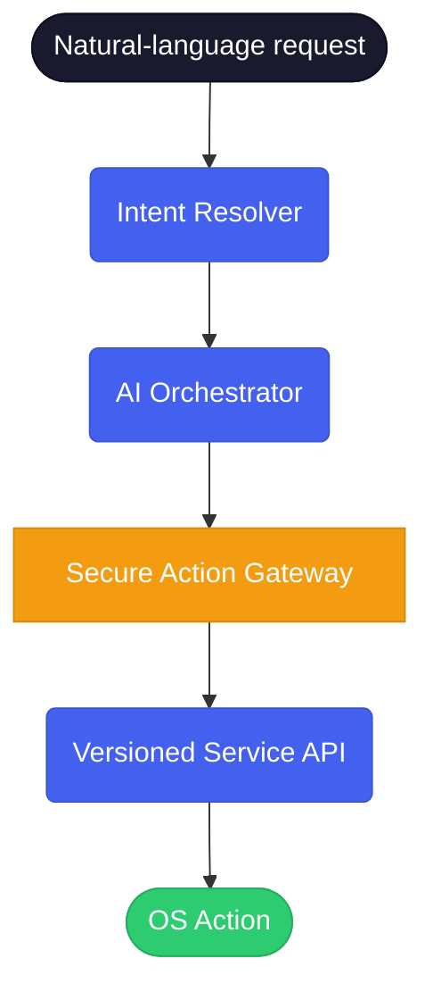
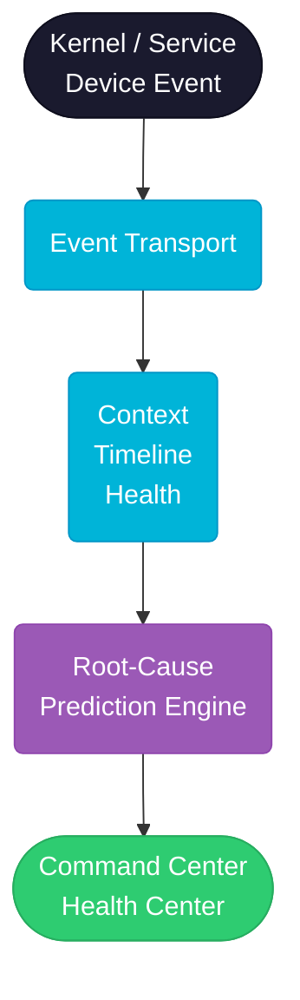
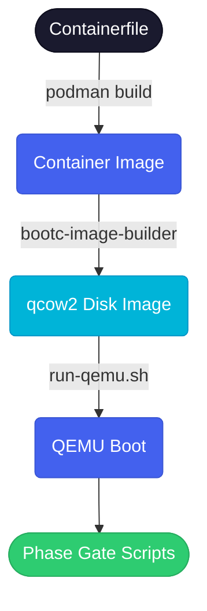

# AntOS Technical Documentation - C: Full Technical Reference

**Project:** AntOS - AI-Native Transport Operating System
**Document type:** Comprehensive Technical Reference
**Source of truth:** `AntOS/AntOS_Master_AI_Build_Specification_FINAL.md`, `AntOS/docs/`, `AntOS/BUILD_STATUS.md`, `AntOS/platform/image/Containerfile`, `AntOS/tooling/`
**Generated:** 2026-08-25

> This document is the consolidated reference. For deeper detail, see:
> - **Document A - Architecture** for architecture focus
> - **Document B - Build & Operations** for build/ops focus

---

## Table of Contents

1. [Product Identity](#1-product-identity)
2. [Product Principles](#2-product-principles)
3. [The Five Transport Planes](#3-the-five-transport-planes)
4. [High-Level Architecture](#4-high-level-architecture)
5. [Technical Foundation](#5-technical-foundation)
6. [Repository Layout](#6-repository-layout)
7. [Architecture Decision Records](#7-architecture-decision-records)
8. [Module Catalog](#8-module-catalog)
9. [Services Catalog](#9-services-catalog)
10. [Shell & Compositor](#10-shell--compositor)
11. [Intelligence Layer](#11-intelligence-layer)
12. [Secure Action Gateway](#12-secure-action-gateway)
13. [Security Architecture](#13-security-architecture)
14. [Installer & Recovery](#14-installer--recovery)
15. [Atomic Updates & Rollback](#15-atomic-updates--rollback)
16. [Hardware Tiers & SFF](#16-hardware-tiers--sff)
17. [Build Pipeline](#17-build-pipeline)
18. [QEMU Validation & Phase Gates](#18-qemu-validation--phase-gates)
19. [Version Management](#19-version-management)
20. [Coding Standards](#20-coding-standards)
21. [Engineering Rules](#21-engineering-rules)
22. [Threat Model Summary](#22-threat-model-summary)
23. [Cross-References](#23-cross-references)

---

## 1. Product Identity

**AntOS** = **(ANT)** _AI-Native Transport_ + **OS** _Operating System_

A Linux-based, Wayland-native, atomic/rollback-capable operating environment that treats the OS as a **trusted transport fabric for intelligence**. It is a modular, contract-driven, security-gated, test-first, reversible OS where user intent, trusted context, system events, knowledge, and authorized actions move through explicit, secure, observable transport layers.

### Naming policy

- Official name: **AntOS** (never `ANTOS`, `Ant OS`, `Ant-OS`, or legacy branding; uppercase only in ASCII diagrams/technical constants).
- Internal components: AntOS Core, AntOS Shell, AntOS Command Center, AntOS Health Center, AntOS Intelligence, AntOS Secure Action Gateway, AntOS Event Transport, AntOS Context Engine, AntOS Model Router, AntOS Automation Engine, AntOS Security Guardian, AntOS Infrastructure Center, AntOS Developer Center, AntOS Agent Center.
- Technical namespace: `antos-core-*`, `antos-shell-*`, `antos-ai-*`, `antos-agent-*`, `antos-platform-*`, `antos-service-*`.
- D-Bus namespace: `org.antos.*`.

### Version (current)

| Field | Value | Source |
|---|---|---|
| Version | 1.0.0 | `CurrentVesion.json` |
| OS Name | AntOS | `CurrentVesion.json` |
| Build Version | 1 | `CurrentVesion.json` |
| Release Date | 2024-08-25 | `CurrentVesion.json` |
| Fedora base | 41 | `Containerfile`, `os-release` |
| Kernel | 6.17.8-100.fc41.x86_64 | Fedora 41 bootc base |
| Latest release gate | v1.2.0 (Phase 0-20) + Phase 21 | `BUILD_STATUS.md` |

---

## 2. Product Principles

| ID | Principle | Summary |
|---|---|---|
| P1 | Local First | Core intelligence, diagnostics, search, monitoring, settings, automations, and basic assistant functions work without Internet. Cloud AI is optional. |
| P2 | AI Is a System Capability, Not a Chatbot | AI is available throughout the shell and services via standard interfaces. The assistant is only one UI to the intelligence layer. |
| P3 | Intent Over Navigation | Users state objectives instead of navigating settings pages. |
| P4 | Explainability | Users can ask "Why is this enabled?", "What changed since yesterday?" |
| P5 | Reversibility | Important changes support preview, snapshot, rollback, undo, or recovery. |
| P6 | Least Privilege | Applications, agents, automations, and AI tools receive the minimum permissions required. |
| P7 | User Authority | AI may recommend strongly, but the user controls policy. Autonomy must be explicit and configurable. |
| P8 | Modular Architecture | No feature may require all of AntOS to be rebuilt or understood at once. |
| P9 | Observability by Design | Every privileged action, automation, AI decision, failure, service state transition, and update produces structured logs/events. |
| P10 | Graceful Degradation | If AI is unavailable, AntOS still operates as a fully usable OS. If cloud is down, local functions remain usable. If a nonessential module crashes, the shell and core OS remain operational. |
| P11 | Beautiful but Functional UI | Visual effects support hierarchy and comprehension, not decoration that harms readability or performance. |
| P12 | Hardware-Aware Intelligence | AntOS understands available CPU, GPU, RAM, NPU, storage, battery, thermals, network devices, and model capacity. |

### Explicit non-goals (v1.x)

AntOS v1.x will NOT: create a new kernel from scratch; create new drivers when Linux drivers exist; replace Linux device support for branding; expose unrestricted root to an LLM; depend on Internet for basic operation; depend on one proprietary model provider; attempt Windows API compatibility; build an entire software ecosystem before core OS stability; replace every Linux userspace component; run arbitrary downloaded AI agents with elevated privileges; implement invisible telemetry; automatically send system logs or personal files to cloud AI.

---

## 3. The Five Transport Planes

"Transport" describes the OS as a policy-controlled coordination and movement layer. Every meaningful flow between intelligence and the OS passes through defined, observable interfaces.

### 3.1 Intent Transport
Carries user goals into structured system requests:


### 3.2 Context Transport
Provides the minimum authorized context required by applications and AI.

### 3.3 Event Transport
Moves structured system, device, security, and infrastructure events:


### 3.4 Action Transport
Carries authorized actions through the Secure Action Gateway into deterministic services.

### 3.5 Knowledge Transport
Connects search, timeline, system state, semantic relationships, and explanations without bypassing privacy policy.

---

## 4. High-Level Architecture

```mermaid
%%{init: {"flowchart": {"useMaxWidth": true}}}%%
flowchart TD
    classDef shellLayer fill:#7209b7,stroke:#560bad,color:#fff
    classDef uxLayer fill:#b5179e,stroke:#9b1160,color:#fff
    classDef aiLayer fill:#00b4d8,stroke:#0096c7,color:#fff
    classDef gatewayLayer fill:#f39c12,stroke:#d68910,color:#fff
    classDef servicesLayer fill:#2ecc71,stroke:#27ae60,color:#fff
    classDef sandboxLayer fill:#95a5a6,stroke:#7f8c8d,color:#fff
    classDef osLayer fill:#4361ee,stroke:#3a56d4,color:#fff
    classDef atomicLayer fill:#e74c3c,stroke:#c0392b,color:#fff
    classDef kernelLayer fill:#1a1a2e,stroke:#0f0f1e,color:#fff

    subgraph S1["AntOS Shell"]
        S["Desktop<br/>Workspaces<br/>Command Center<br/>Panels<br/>Notifications"]
    end
    subgraph S2["User Experience Services"]
        U["Search<br/>Timeline<br/>Clipboard<br/>Settings<br/>Files<br/>Accessibility"]
    end
    subgraph S3["System Intelligence Layer"]
        A["Context<br/>AI Router<br/>Reasoning<br/>Agents<br/>Predictions<br/>RCA"]
    end
    subgraph S4["Secure Action Gateway"]
        G["Capability<br/>Policy<br/>Consent<br/>Impact<br/>Audit<br/>Undo"]
    end
    subgraph S5["AntOS Core Services"]
        C["Health<br/>Security<br/>Network<br/>Devices<br/>Automation<br/>Knowledge"]
    end
    subgraph S6["Application<br/>Agent Sandbox"]
        X["Flatpak<br/>Portals<br/>Rootless Containers<br/>Agent Capabilities"]
    end
    subgraph S7["OS Services"]
        O["systemd<br/>NetworkManager<br/>PipeWire<br/>BlueZ<br/>D-Bus"]
    end
    subgraph S8["Atomic<br/>Image-Based OS"]
        T["Updates<br/>Deployments<br/>Recovery<br/>Btrfs<br/>Boot"]
    end
    subgraph S9["Linux Kernel"]
        K["CPU<br/>Memory<br/>GPU<br/>Storage<br/>Network<br/>USB<br/>Input"]
    end

    S --> U --> A --> G --> C --> X --> O --> T --> K
    class S shellLayer
    class U uxLayer
    class A aiLayer
    class G gatewayLayer
    class C servicesLayer
    class X sandboxLayer
    class O osLayer
    class T atomicLayer
    class K kernelLayer
```



Layers are strictly ordered: each layer may only depend on layers below it. The Secure Action Gateway is the only path from the intelligence layer to privileged OS services.

---

## 5. Technical Foundation

| Layer | Choice | ADR / Source |
|---|---|---|
| Kernel | Upstream Linux via Fedora 41 (`6.17.8-100.fc41.x86_64`) | ADR-0001 |
| System image | Atomic/image-based via rpm-ostree / bootc | ADR-0001, ADR-0002 |
| Init/service manager | systemd | master spec sec. 4 |
| Display protocol | Wayland | master spec sec. 4 |
| Compositor | Custom AntOS Shell on Smithay (Rust) | ADR-0004 |
| Core language | Rust | master spec sec. 4 |
| UI toolkit | Qt/QML + Rust bindings + AntOS design-system | ADR-0003 |
| AI tooling | Python behind stable service contracts | master spec sec. 4 |
| Desktop app isolation | Flatpak + portals | master spec sec. 4 |
| Containers | Podman, rootless by default | master spec sec. 4 |
| Filesystem | Btrfs where supported | master spec sec. 4 |
| Audio | PipeWire | master spec sec. 4 |
| Networking | NetworkManager | master spec sec. 4 |
| Bluetooth | BlueZ | master spec sec. 4 |
| IPC (primary) | D-Bus + versioned AntOS service APIs | ADR-0005 |
| IPC (high-throughput) | gRPC / typed channels | ADR-0005 |
| Structured events | AntOS Event Bus abstraction | ADR-0005 |
| Logging | journald + structured AntOS event store | master spec sec. 4 |
| Local model runtime | Provider abstraction, Ollama first | master spec sec. 4 |
| Security policy | SELinux (Fedora default) | ADR-0001 |
| Boot | UEFI | master spec sec. 4 |
| Installer | Separate module (Anaconda addon) | master spec sec. 4 |
| Update strategy | Atomic update, health verification, automatic rollback | ADR-0002 |

### Why Fedora was chosen (ADR-0001)

1. **rpm-ostree** provides atomic, image-based updates with built-in rollback.
2. **Fedora Silverblue** ships a maintained Wayland/PipeWire/systemd/NetworkManager/SELinux stack.
3. **Toolchain alignment** - rpm-ostree + OSTree + podman match the master spec's container/isolation strategy.

Ubuntu was explicitly rejected because "snap integration conflicts with the goal of a single primary packaging/isolation story." Debian rejected (no atomic by default). Arch rejected (maintenance burden). Fedora CoreOS/IoT rejected (server-only).

---

## 6. Repository Layout

```text
AntOS/
|-- AntOS_Master_AI_Build_Specification_FINAL.md  - authoritative architecture
|-- AntOS_Build_Execution_Guide.md  - step-by-step to v1.0
|-- AntOS_AI_Command_Template.md  - copy-paste build commands
|-- AntOS_Phase21_AI_Command_Template.md  - Phase 21 (ARM/SFF) commands
|-- BUILD_STATUS.md  - phase progress (single source of truth)
|-- CurrentVesion.json  - version metadata source of truth
|-- MODULE.md  - root module definition
|-- README.md, CONTRIBUTING.md, SECURITY.md
|
|-- docs/
|   |-- architecture/  - high-level structure, transport planes, repo layout
|   |-- adr/  - ADR-0001..0021
|   |-- threat-models/  - initial + evolving threat models
|   |-- ux/  - UX research and design
|   |-- api/  - public API definitions (D-Bus XML: org.antos.Shell1)
|   |-- operations/  - build, release, rollback, phase plans, ISO playbook
|   |-- design-system/  - UI design system reference
|   |-- coding-standards.md
|   `-- releases/
|
|-- contracts/
|   |-- dbus/  - D-Bus interface contracts (org.antos.*)
|   |-- capabilities/  - policy-schema.json + default-policy.json
|   |-- events/  - event schema definitions
|   |-- protobuf-or-schema/  - gRPC/protobuf contracts
|   `-- versioning/  - requirement-ids.md (<DOMAIN>-<AREA>-<NNN>)
|
|-- platform/
|   `-- image/
|       |-- Containerfile  - multi-stage bootable container build
|       |-- branding/  - icons, wallpapers, logos
|       `-- config/  - os-release, journald, recovery, sudoers
|
|-- shell/
|   |-- compositor/  - Smithay Wayland compositor (Rust)
|   |-- api/  - Shell D-Bus API service
|   `-- ui/  - Qt/QML shell UI + design-system
|
|-- services/
|   |-- action-gateway/  - Secure Action Gateway
|   |-- health/  - System health/sysinfo
|   |-- security/  - Security Guardian / capability
|   |-- devices/  - Hardware profile detection
|   |-- automation/  - Whitelisted command execution
|   |-- knowledge/  - Notes / knowledge base
|   |-- installer/  - Rollback status client
|   |-- beta/  - Service status
|   |-- interaction/  - Input status
|   |-- connectivity/  - Network status
|   |-- productivity/  - Focus
|   `-- advanced/  - Feature flags
|
|-- intelligence/
|   |-- Cargo.toml  - antos-intelligence-dbus
|   |-- providers/  - Provider manifest (Ollama first)
|   `-- client/  - antos-list-providers
|
|-- apps/
|   `-- command-center/  - Search index + D-Bus search service
|
|-- integrations/  - Flatpak, Podman, Ollama, smart-home, SSH, NAS
|-- installer/
|   |-- anaconda-addon/  - com_antos_account GUI spoke
|   `-- first-boot/  - antos-first-boot wizard + service
|-- sdk/  - Rust, Python, examples
|-- tests/  - unit, contract, integration, security, performance,
|                                accessibility, UI, QEMU, recovery
|-- tooling/
|   |-- image-builder/  - build.sh, bib-common.sh, build-iso.sh
|   |-- vm-runner/  - run-qemu.sh, phase gate scripts
|   |-- ci/  - antos-ci.sh
|   `-- dev/, release/, lint/
`-- releases/
```

Every major directory MUST contain a `MODULE.md` (purpose, owned/explicit non-responsibilities, public/consumed interfaces, events, privileges, data, privacy, failure behavior, security boundaries, tests, definition of done).

---

## 7. Architecture Decision Records

### Accepted ADRs

| ADR | Title | Status | Decision |
|---|---|---|---|
| ADR-0001 | Base distribution | Accepted | Fedora Silverblue / rpm-ostree. Ubuntu rejected (snap conflict). |
| ADR-0002 | Atomic deployment | Accepted | OSTree via rpm-ostree, A/B boot entries, health-verified activation. |
| ADR-0003 | Desktop toolkit | Accepted | Qt/QML with Rust bindings + AntOS design-system. |
| ADR-0004 | Wayland compositor | Accepted | Smithay (Rust), wlroots fallback if needed. |
| ADR-0005 | Primary IPC | Accepted | D-Bus (desktop/system) + gRPC (high-throughput) + Event Bus. |
| ADR-0021 | ARM64 / SFF | Proposed | Multi-arch build + hardware-profile service. Bare-metal SBC deferred to Phase 22. |

### Planned ADRs (0006-0020)

Event schema - Settings storage - Search/index DB - Local AI provider interface - Security policy system - Update signing/trust - Secure Action Gateway authorization - Encryption/secret storage - Installer framework - Agent package format - Smart-home abstraction - Telemetry/privacy storage - UI design system - Semantic embedding storage - Crash reporting policy.

### ADR process

1. Open/update with status `Proposed`. 2. Architecture review. 3. Move to `Accepted`/`Superseded`/`Rejected`. 4. Update affected `MODULE.md` files.

---

## 8. Module Catalog

### 8.1 Root (`AntOS/MODULE.md`)
Owns: master spec, conventions, build status, cross-module contracts, phased build plan.
Does NOT own: compositor/shell implementation, individual services, AI orchestration.

### 8.2 Platform (`platform/MODULE.md`)
Owns: OS image composition, bootloader config, atomic update/rollback, recovery environment, hardware profile detection.
Does NOT own: compositor logic, AI routing, application permissions.
All destructive operations require explicit gating and audit.

### 8.3 Shell (`shell/`)
- **compositor/** - Smithay Wayland compositor (Rust). See sec. 10.
- **api/** - Shell D-Bus API (`org.antos.Shell1`). See sec. 10.
- **ui/** - Qt/QML shell UI + design-system components.

### 8.4 Services (`services/MODULE.md`)
13 cross-cutting service areas. See sec. 9.

### 8.5 Intelligence (`intelligence/`)
`antos-intelligence-dbus` (`org.antos.Intelligence1`), provider manifest (Ollama first). See sec. 11.

### 8.6 Installer (`installer/MODULE.md`)
Live image, installer UI, first-boot wizard, partitioning/encryption, recovery, migration, support bundles. See sec. 14.

### 8.7 Contracts (`contracts/`)
Versioned D-Bus, capability policy, event schema, protobuf, requirement ID definitions. See sec. 12.

### 8.8 Apps (`apps/`)
First-party applications. Current: `command-center/` (search index + D-Bus search service).

### 8.9 Integrations (`integrations/`)
Flatpak, Podman, Ollama, smart-home, zigbee, SSH, NAS.

### 8.10 SDK (`sdk/`)
Rust, Python, and example integrations for third-party developers.

---

## 9. Services Catalog

Per `services/MODULE.md`, the services module owns 13 cross-cutting service areas forming the deterministic nervous system of AntOS. All privileged actions pass through the Secure Action Gateway.

| Service | Phase | D-Bus interface | Client binary | Status |
|---|---|---|---|---|
| action-gateway | 5 | `org.antos.Policy1` | `antos-policyd`, `antos-policy-gateway` | Passed |
| command-center | 6 | `org.antos.CommandCenter1` | `antos-search` | Passed |
| intelligence | 7, 8 | `org.antos.Intelligence1` | `antos-list-providers` | Passed |
| health | 9 | (sysinfo timer) | `antos-sysinfo` | Passed |
| automation | 10 | (whitelist executor) | `antos-run-command` | Passed |
| knowledge | 11 | (notes) | `antos-note`, `antos-list-notes`, `antos-delete-notes` | Passed |
| security | 12 | (capability) | `antos-capability`, `antos-security-status` | Passed |
| developer | 13 | (build info) | `antos-build-info` | Passed |
| installer | 14 | (rollback status) | `antos-rollback-status` | Passed |
| beta | 15 | (service status) | `antos-service-status` | Passed |
| interaction | 16 | (input status) | `antos-input-status` | Passed |
| connectivity | 17 | (network status) | `antos-network-status` | Passed |
| productivity | 19 | (focus) | `antos-focus` | Passed |
| advanced | 20 | (feature flags) | `antos-feature` | Passed |
| devices | 21 | (hardware profile) | `antos-hardware-profile` | Passed |

Planned but not yet implemented as separate services: event-bus, context, timeline, backup, update-intelligence, energy.

---

## 10. Shell & Compositor

### 10.1 Compositor (`shell/compositor/`)

**Package:** `antos-shell-compositor` (Rust 2021 edition, rust-version 1.80.1)
**Dependency:** Smithay 0.7 with features: `wayland_frontend`, `backend_drm`, `backend_gbm`, `renderer_pixman`.

**Wayland protocols implemented:**
- `wl_compositor`, `wl_shm` - basic surface and buffer management
- `xdg_wm_base` - application window management
- `wl_output` - display output advertisement (multi-display: two synthetic `antos-0`/`antos-1` outputs in headless mode; real DRM output when available)
- `wl_seat` - keyboard and pointer input

**DRM/GBM path** (`shell/compositor/src/drm.rs`):
1. Opens `/dev/dri/card0`, creates `DrmDevice`.
2. Finds connected connector + encoder + CRTC, creates `DrmSurface`.
3. Creates `GbmDevice`, `GbmAllocator` (SCANOUT), `GbmBufferedSurface`.
4. Creates `PixmanRenderer`, derives DMA-BUF formats, falls back to `Xrgb8888` linear.
5. Creates `antos-drm` `Output`, sets mode/transform/scale/location, advertises via `Output::create_global`.
6. `DrmBackend::render_frame` - calls `next_buffer`, binds `Dmabuf`, clears to `Color32F(0.02, 0.02, 0.03, 1.0)`, finishes frame, queues buffer.
7. One-shot `frame_queued` guard renders only the first visible test frame; headless fallback preserved for non-DRM environments.

**Open DRM/GBM sub-slices** (per `antos-drm-visible-frame-step1.md`):
1. Wire QML surface into render loop using `WaylandSurfaceRenderElement`.
2. Add vblank/page-flip event loop (`frame_submitted` not yet wired).
3. Add QEMU display-device gate using `virtio-gpu` + VNC/SPICE.
4. Add runtime DRM permissions via `libseat` or `video`/`render` group membership.

### 10.2 Shell API (`shell/api/`)

**Service:** `antos-shell-api-dbus` - exposes `org.antos.Shell1` on D-Bus.

**Methods/signals:**
- `Ping` - health check
- `GetSessionState` - returns current session state
- `RaiseError` - typed error reporting
- `StateChanged` signal - session state change notifications
- `SessionState` property - current session state

**Clients:** `antos-session-status`, `antos-test-error`, `antos-watch-state`, `antos-shell-property`.

### 10.3 Shell UI (`shell/ui/`)

**Binary:** `antos-shell-ui` (Qt/QML)
**Design system:** `docs/design-system/` - component library including `Card`, `KpiCard`, `StatusChip`, `ListItem`, `SearchField`, `SwitchToggle`, `IconButton`, `Badge`, `AppLauncherTile`, `ToolLauncher`, `NotificationItem`, `CommandOutput`, `SmartSuggestion`, `RailButton`, `TopBar`.

### 10.4 Session wiring

`antos-wayland-session.target` (systemd user target) wires:
- `antos-shell-compositor.service`
- `antos-shell-api-dbus.service`
- `antos-intelligence-dbus.service`
- `antos-command-center.service`
- `antos-shell-ui.service`

User session lingering is enabled for `antos` so the compositor starts at boot without interactive login. Default target is `multi-user.target` (headless boot); the compositor starts via the user session.

---

## 11. Intelligence Layer

### 11.1 Service

`antos-intelligence-dbus` - exposes `org.antos.Intelligence1` on D-Bus.

### 11.2 Provider abstraction

`intelligence/providers/manifest.json` defines available AI providers. **Ollama is supported first** per the master spec. Cloud AI is optional (P1 - Local First).

### 11.3 Policy enforcement (Phase 8)

`CanUseProvider` - policy enforcement gate that checks whether a given AI provider may be used. Enforced through the Secure Action Gateway.

### 11.4 Privacy gateway

The Privacy Gateway ensures no AI access to raw sensitive events without authorization. The Event Bus classifies events and enforces privacy policy.

### 11.5 Client

`antos-list-providers` - CLI client to list available AI providers.

---

## 12. Secure Action Gateway

### 12.1 Purpose

The **only path** from intelligence/automation to privileged OS actions. Enforces six gates:

| Gate | What it checks |
|---|---|
| Capability | What action is requested |
| Policy | allow/deny/prompt per `default-policy.json` |
| Consent | User confirmation for high-risk actions |
| Impact | Preview of what will change |
| Audit | Structured log of every decision |
| Undo | Reversibility where technically possible |

### 12.2 Components

- `antos-policyd` - policy daemon (`org.antos.Policy1` D-Bus service)
- `antos-policy-gateway` - gateway service

### 12.3 Policy schema

`contracts/capabilities/policy-schema.json` - JSON Schema for policy rules.
`contracts/capabilities/default-policy.json` - default rules with risk classes:

| Risk class | Meaning | Example |
|---|---|---|
| R0 | Trivial, auto-allow | `org.antos.Shell1.Ping` |
| R1-R3 | Low-to-medium, contextual | (varies) |
| R4 | High, prompt user | `org.antos.capability.install.update` |
| R5 | Destructive, deny by default | `org.antos.capability.format.disk` |

### 12.4 Requirement IDs

`contracts/versioning/requirement-ids.md` defines `<DOMAIN>-<AREA>-<NNN>`:
- Domains: CORE, SHELL, SERV, AI, SEC, HEALTH, AUTO, UPDATE, INFRA, APP
- Example: `CORE-ACT-001`
- IDs must appear in MODULE.md, contracts, and tests.

---

## 13. Security Architecture

### 13.1 Threat model (`docs/threat-models/initial-threat-model.md`)

14 threat categories including: malicious applications, compromised AI models, prompt injection, supply-chain compromise, privilege escalation, data exfiltration, rollback attacks.

**Critical rule:** External text must never be trusted as system instructions.

### 13.2 SELinux

Fedora ships SELinux in enforcing mode by default. ADR-0001 chose Fedora partly because the threat model prefers SELinux over AppArmor. Switching MAC frameworks requires a superseding ADR.

### 13.3 Application isolation

- **Flatpak + portals** for desktop apps
- **Podman rootless** containers
- **Agent capabilities** - least privilege per agent

### 13.4 Atomic update security

- Deployments are read-only and signed.
- Rollback cannot be blocked by a running application (boot loader owns previous entry).
- Health verification runs in a sandboxed environment before deployment is made default.
- Supply-chain risk inherited from Fedora mirrors; signing and reproducible builds must be enforced.

### 13.5 UEFI trust path (aarch64)

AAVMF UEFI boot chain introduces a new firmware trust path. AAVMF must be packaged from a Fedora-signed source (ADR-0021).

---

## 14. Installer & Recovery

### 14.1 Installer module (`installer/MODULE.md`)

Owns: live image environment, installer UI, first-boot account setup wizard, disk partitioning/encryption, recovery interface, migration intelligence, support bundle generation.

Security: signed installer packages, user-controlled encryption, privacy scans during migration.

### 14.2 Anaconda addon

`installer/anaconda-addon/com_antos_account/` - GUI spoke for account creation during install.
- `gui/spokes/account.py` - spoke logic
- `gui/spokes/account.glade` - UI layout
- `99-antos.conf` - configuration

### 14.3 First-boot wizard

`installer/first-boot/antos-first-boot` - interactive password collection on first boot.
`antos-first-boot.service` - runs only when `/etc/antos-first-boot` exists (i.e., when no `CONSOLE_PASSWORD` was supplied at build time).

### 14.4 Recovery

- `antos-recovery.target` - dedicated systemd recovery target
- `antos-recovery-shell.service` + `/usr/local/bin/antos-recovery-shell` - serial console recovery shell
- `/usr/local/bin/antos-prepare-rollback-test` - rollback test preparation

---

## 15. Atomic Updates & Rollback

### 15.1 Mechanism (ADR-0002)

OSTree via rpm-ostree/bootc:
- Content-addressed, immutable deployment trees in `/ostree/repo`
- A/B boot entries with automatic fallback on failed boot
- Health verification before deployment is made default
- Rollback is boot-loader-owned - cannot be blocked by running applications

### 15.2 Operator commands

```bash
bootc status      # View current and previous deployments
bootc rollback    # Roll back to previous deployment
```

### 15.3 Verification

```bash
tooling/rollback/verify-rollback.sh
tooling/vm-runner/test-rollback.sh   # End-to-end rollback test (Phase 1 gate)
```

### 15.4 Three distinct concepts

| Concept | What it is | What it is NOT |
|---|---|---|
| OS deployment rollback | rpm-ostree A/B boot entry switch | Not a backup |
| Btrfs snapshots | Efficient local filesystem state | Not a backup; not the primary rollback |
| User backups | Separate user-data backup | Not OS rollback |

---

## 16. Hardware Tiers & SFF

### 16.1 Hardware tiers (master spec)

AntOS defines hardware support tiers. Tier E is **ARM64 / Small Form Factor** (Raspberry Pi or equivalent) - a later profile that must not force compromises into the x86_64 v1 architecture.

### 16.2 Multi-arch build (ADR-0021, Phase 21)

- `build.sh --arch {x86_64,aarch64}` - default x86_64
- `quay.io/fedora/fedora-bootc:41` is multi-arch
- `run-qemu.sh --arch {x86_64,aarch64}` - aarch64 uses `qemu-system-aarch64 -machine virt -cpu cortex-a72 -bios AAVMF_CODE.fd`
- x86_64 remains primary; ARM is additive
- Cross-build on WSL blocked by upstream BIB/qemu-user-static; use native ARM host

### 16.3 Hardware profile service

`antos-hardware-profile` detects:
- Device-tree model on ARM SBCs
- DMI chassis type on x86_64 SFF/NUC
- QEMU `virt` machine (with `--sff` override)

Emits `/run/antos/hardware-profile.json`.

### 16.4 SFF tuning

`services/devices/config/sff-tuning.json`:
- Compositor refresh: 30Hz
- CPU governor: powersave
- Disabled services: `antos-command-center`, `antos-intelligence-dbus`
- Resource hints: max 4GB RAM, 4 CPU cores

### 16.5 Bare-metal Pi status

**Not yet supported.** Phase 21 validated aarch64 only under QEMU. Bare-metal SBC bring-up (VideoCore, Wi-Fi/BT firmware, Pi UEFI) is deferred to Phase 22. Known issues for Pi:
- DRM/GBM visible-frame path unverified on Pi GPU (V3D/V3DV)
- Wi-Fi/BT firmware not handled
- SELinux overhead significant on Pi 4 (4GB)
- Local AI (Ollama) not viable on Pi 4; marginal on Pi 5 (8GB)
- SFF profile disables Command Center + Intelligence services
- Pi UEFI is a different trust root than Fedora-signed AAVMF

---

## 17. Build Pipeline

### 17.1 Flow



### 17.2 Containerfile structure

**Stage 1 - Builder** (`quay.io/fedora/fedora:41`):
- Compiles 5 Rust crates with Cargo dependency caching (dummy build -> real source)
- Builder deps: cargo, rust, libxkbcommon-devel, wayland-devel, libdrm-devel, libgbm-devel, pixman-devel, pkgconf, gcc

**Stage 2 - Final** (`quay.io/fedora/fedora-bootc:41`):
- Runtime packages: NetworkManager, systemd-resolved, qemu-guest-agent, openssh, sudo, libxkbcommon, wayland-utils, libdrm, libgbm, pixman, weston, dbus, qt6 stack, python3-jsonschema, dialog
- Branding: os-release, issue, hostname, GRUB, profile prompt, icons, wallpapers, plymouth
- User: antos (UID 1000, wheel + systemd-journal)
- Services: NetworkManager, systemd-resolved, qemu-guest-agent, sshd, antos-recovery-shell, antos-hardware-profile, antos-first-boot
- User session: lingering enabled, antos-wayland-session.target wires compositor + API + intelligence + command-center + shell-ui
- Default target: multi-user.target (headless boot; compositor via user session)

### 17.3 Build commands

```bash
# x86_64 (default)
tooling/image-builder/build.sh

# aarch64
tooling/image-builder/build.sh --arch aarch64

# Container only (skip qcow2)
tooling/image-builder/build.sh --skip-qcow2

# ISO
tooling/image-builder/build-iso.sh --arch <arch> [--no-test]
```

### 17.4 Build args

| Variable | Default | Purpose |
|---|---|---|
| `ANTOS_BUILD_LABEL` | `AntOS` | MOTD label |
| `ANTOS_CONSOLE_PASSWORD` | (empty) | Pre-set password; skips first-boot wizard |
| `ANTOS_BASE_VERSION` | `41` | Fedora base version |

Version metadata from `CurrentVesion.json`: Version, OSName, BuildVersion, ReleaseDate.

### 17.5 Prerequisites

podman, qemu-img, qemu-system-x86_64, qemu-system-aarch64, edk2-aarch64 (AAVMF), ssh-keygen, python3, qemu-user-static (cross-arch).

---

## 18. QEMU Validation & Phase Gates

### 18.1 Gate convention

- Phase gate: `tooling/vm-runner/phase<N>-gate.sh`
- Sub-slice gate: `tooling/vm-runner/phase<N>-<M>-gate.sh`
- Full regression: `tooling/vm-runner/antos-full-gate.sh`
- CI lint: `tooling/ci/antos-ci.sh`

### 18.2 Phase status (v1.2.0 + Phase 21)

| Phase | Status | Headline deliverable |
|---|---|---|
| 0 | Passed | Reproducible minimal image boots in QEMU |
| 1 | Passed | boot/reboot/shutdown stable, rollback works |
| 2 | Passed | Wayland desktop foundation (wl_compositor, xdg_wm_base, multi-display, input) |
| 3 | Passed | Design system + core shell (15 QML components) |
| 4 | Passed | Core D-Bus APIs (org.antos.Shell1) |
| 5 | Passed | Secure Action Gateway (policyd + policy schema) |
| 6 | Passed | Command Center (search index + D-Bus) |
| 7 | Passed | Local AI Foundation (provider manifest, Intelligence1) |
| 8 | Passed | Explainable Intelligence (CanUseProvider) |
| 9 | Passed | Health/Infrastructure (sysinfo + timer) |
| 10 | Passed | Automation (whitelist executor) |
| 11 | Passed | Knowledge (notes) |
| 12 | Passed | Security Guardian (capability) |
| 13 | Passed | Developer/Device (build-info) |
| 14 | Passed | Installer/Recovery (rollback-status) |
| 15 | Passed | Beta Hardening (service-status, full-gate) |
| **v1.0** | **Passed** | Baseline (Phase 0-15) |
| 16 | Passed | Interaction/Accessibility (input-status) |
| 17 | Passed | Connectivity (network-status) |
| 18 | Passed | Security/Privacy (security-status) |
| **v1.1** | **Passed** | Release (Phase 0-18) |
| 19 | Passed | Productivity (focus) |
| 20 | Passed | Advanced (feature flags) |
| **v1.2** | **Passed** | Release (Phase 0-20) |
| 21 | Passed | ARM64/SFF (multi-arch, aarch64 QEMU, SFF profile) |

### 18.3 Status definitions

Not Started -> In Progress -> Blocked -> Passed (all gate criteria verified and documented).

---

## 19. Version Management

### 19.1 Source of truth

`CurrentVesion.json`:
```json
{
  "Version": "1.0.0",
  "OSName": "AntOS",
  "BuildVersion": 1,
  "ReleaseDate": "2024-08-25"
}
```

### 19.2 Build-info

`/usr/share/antos/build-info.json` - label, version, build_version, release_date, commit, timestamp. Query: `antos-build-info`.

### 19.3 os-release

- `NAME`/`PRETTY_NAME` = AntOS product name + version
- `ID=fedora` / `ID_LIKE=fedora` (required by BIB/dnf)
- `VERSION_ID` = integer Fedora base (41)
- `BUILD_ID` = AntOS build version

### 19.4 Kernel version string

Running kernel reports `6.17.8-100.fc41.x86_64` via `uname -r`. This is a build-time identifier; changing it requires a custom kernel `LOCALVERSION`. Acceptable to leave as-is.

---

## 20. Coding Standards

(`docs/coding-standards.md`)

| Area | Standard |
|---|---|
| Core language | Rust |
| Shell/UI | Qt/QML |
| AI tooling | Python (behind stable service contracts) |
| File naming | kebab-case |
| Requirement IDs | `<DOMAIN>-<AREA>-<NNN>` (e.g., `CORE-ACT-001`) |
| Product name | "AntOS" (never `ANTOS`, `Ant OS`, `Ant-OS`) |
| Formatters | Rust: `cargo fmt`; QML: `qmlformat`; Python: `black`/`ruff` |
| Secrets | Never commit secrets/keys/certs. Stop and report path only. |
| Error handling | Explicit; no silent failures |
| Definition of done | Beyond "code compiles" - tests, contracts, observability, rollback, docs |

---

## 21. Engineering Rules

(Master spec sec. 0)

1. Never generate the entire AntOS source tree in one pass.
2. Build through modules and phases.
3. Before modifying code, read: master spec, target MODULE.md, applicable ADRs, contracts, existing tests.
4. Every module MUST expose versioned contracts. Cross-module calls MUST use contracts.
5. No module may silently introduce a second framework, event bus, permissions system, AI abstraction, or settings backend.
6. Privileged operations MUST flow through the Secure Action Gateway.
7. New functionality MUST have: requirement ID, module owner, threat assessment, API definition, tests, observability, rollback strategy, user-facing explanation.
8. Do not refactor unrelated modules while implementing a feature.
9. Do not replace working architecture merely because another library appears easier.
10. If a requested change conflicts with the master spec, stop and produce an ADR proposal first.
11. Prefer deterministic system APIs over generated shell commands.
12. Prefer local processing for sensitive information.
13. No cloud AI service is a hard dependency for core OS functionality.
14. Every AI-driven destructive/security-sensitive action must be explainable, auditable, policy-controlled, and reversible where possible.
15. A phase is not complete until all of its release gates pass.

> **AntOS engineering rule:** Architecture first. Contract second. Implementation third. Integration fourth. Intelligence fifth.

---

## 22. Threat Model Summary

(`docs/threat-models/initial-threat-model.md`)

### 22.1 Threat categories (14)

Including: malicious applications, compromised AI models, prompt injection, supply-chain compromise, privilege escalation, data exfiltration, rollback attacks, and more.

### 22.2 Critical rule

External text must never be trusted as system instructions.

### 22.3 Design-time mitigations

- Secure Action Gateway (capability + policy + consent + impact + audit + undo)
- Privacy Gateway (no AI access to raw sensitive events without authorization)
- Atomic updates with signed, read-only deployments
- Least privilege (Flatpak + portals, Podman rootless, agent capabilities)
- SELinux enforcing by default

---

## 23. Cross-References

| Resource | Path |
|---|---|
| Master specification | `AntOS/AntOS_Master_AI_Build_Specification_FINAL.md` |
| Build execution guide | `AntOS/AntOS_Build_Execution_Guide.md` |
| AI command template | `AntOS/AntOS_AI_Command_Template.md` |
| Phase 21 command template | `AntOS/AntOS_Phase21_AI_Command_Template.md` |
| Build status | `AntOS/BUILD_STATUS.md` |
| Version metadata | `AntOS/CurrentVesion.json` |
| Root module | `AntOS/MODULE.md` |
| ADR index | `AntOS/docs/adr/README.md` |
| Threat model | `AntOS/docs/threat-models/initial-threat-model.md` |
| Coding standards | `AntOS/docs/coding-standards.md` |
| Phase build plan | `AntOS/docs/operations/phase-build-plan.md` |
| Rollback docs | `AntOS/docs/operations/rollback.md` |
| ISO rebuild playbook | `AntOS/docs/operations/feature-and-iso-rebuild-playbook.md` |
| D-Bus API | `AntOS/docs/api/dbus/org.antos.Shell1.xml` |
| Capability policy | `AntOS/contracts/capabilities/default-policy.json` |
| Requirement IDs | `AntOS/contracts/versioning/requirement-ids.md` |
| Containerfile | `AntOS/platform/image/Containerfile` |
| Build script | `AntOS/tooling/image-builder/build.sh` |
| QEMU runner | `AntOS/tooling/vm-runner/run-qemu.sh` |
| CI script | `AntOS/tooling/ci/antos-ci.sh` |
| Document A - Architecture | `AntOS-Technical-Documentation-A-Architecture.md` |
| Document B - Build & Ops | `AntOS-Technical-Documentation-B-BuildOps.md` |
