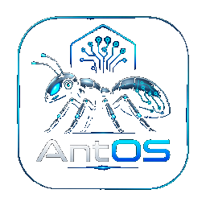

# AntOS
The AI-Native Transport Operating System

  

# AntOS - Your Computer, But Smarter

> What if your computer actually understood what you wanted?

AntOS is a new kind of operating system - the software that runs your computer - built from the ground up to work **with you**, not just **for** you. It understands what you're trying to do, explains what's happening, fixes problems before you even notice them, and keeps your data private by design.

You don't need to be a tech expert to use it. You don't need to know what a "kernel" is or how to configure a firewall. AntOS handles the hard stuff so you can focus on your work, your creativity, and your life.

---

## Why AntOS Is Different

Most operating systems were designed decades ago, before AI existed, before privacy became a daily concern, before computers became the center of everything we do. They've been patched and updated, but the foundation hasn't changed.

AntOS starts from a clean slate. It's built for the way you actually use a computer today - with natural language, with AI assistance, with dozens of apps running at once, with real privacy concerns, and with the expectation that things should just work.

### The big idea

AntOS treats your computer as an **intelligent partner** that:

- Understands what you mean, not just what you type
- Explains what's happening in plain language
- Protects your data and privacy by default
- Fixes itself when something goes wrong
- Works perfectly offline - no Internet required for the basics
- Gets smarter the more you use it, but never sends your personal data to the cloud unless you choose to

---

## What You Can Do With AntOS

### Just say what you want

Instead of clicking through five settings menus to change your Wi-Fi network, you just say:

> "Switch to the faster Wi-Fi."

AntOS understands your intent, figures out which network is faster, and switches for you. No menus. No confusion. No searching through control panels.

This works across the entire system - network settings, display preferences, power management, app launches, file organization, and more.

### Ask "Why?" and get a real answer

Ever wondered why your fan is loud, why your battery is draining fast, why an app crashed, or why your Wi-Fi keeps disconnecting? AntOS can tell you - in plain language.

> "Why is my fan so loud?"
>
> **AntOS:** "Your video editor is using 87% of your CPU to render a 4K export. It should finish in about 4 minutes. Want me to pause the render to cool things down?"

No more guessing. No more searching forums for answers. AntOS explains what's happening, why it's happening, and what you can do about it.

### Get help before things break

AntOS watches your system's health in the background and warns you about problems before they become disasters:

- "Your storage drive is 92% full. Want me to help you find large files to clean up?"
- "Your battery health has dropped to 78%. It may need replacement in the next few months."
- "An app crashed twice this week. I've found a newer version that fixes the issue - want to update?"

It's like having a friendly IT person looking over your shoulder, but one that never sleeps and never judges.

### Undo anything

Made a mistake? Changed a setting that made things worse? Installed something you regret? AntOS is built so that **almost every change can be undone**:

- System updates can be rolled back with one click if anything goes wrong
- Settings changes show a preview before they take effect
- Deleted files can be recovered
- App installs can be cleanly removed without leaving junk behind

You never have to worry about "breaking" your computer. There's always a way back.

---

## Your Privacy Comes First

### Your data stays on your computer

AntOS is built to work **completely offline**. You do not need an Internet connection to:

- Use the desktop and all built-in apps
- Search your files and settings
- Get system health reports and diagnostics
- Use the AI assistant for local tasks
- Run automations and workflows

Your personal files, your search history, your usage patterns, your system logs - none of it leaves your computer unless you explicitly choose to share it.

### AI that doesn't spy on you

AntOS includes AI assistance built into the system, but it's designed differently from cloud-based AI:

- The AI runs **on your computer**, not on someone else's server
- It processes your requests locally whenever possible
- It does not send your personal data to cloud services without your permission
- You can remove the AI provider entirely and AntOS still works perfectly as a regular operating system
- Every AI action is logged - you can see exactly what the AI did and why

### You're in charge

AntOS may recommend things strongly, but **you always have the final say**:

- The AI can suggest, but it cannot act without your approval for anything important
- You control what the AI is allowed to do
- You can turn off AI features entirely and use AntOS as a traditional desktop
- Every permission is explicit - no hidden access, no silent background actions

---

## It Just Works

### Never break your computer again

AntOS uses a modern update system called "atomic updates." Here's what that means for you:

When AntOS updates itself, it doesn't modify your current system in place. Instead, it builds a complete fresh copy in the background, checks that it works, and only then switches you over. If anything goes wrong, it automatically switches back to the previous version - **you never see a broken screen or a failed boot**.

- Updates happen in the background
- If an update causes problems, you're automatically rolled back
- You can manually switch back to any previous version with one click
- No more "update broke my computer" anxiety

### Apps that can't hurt your system

Every app on AntOS runs in its own protected space - it can't touch the core system, can't access your files without permission, and can't interfere with other apps. This means:

- A buggy app can't crash your computer
- A malicious app can't steal your data
- Installing and removing apps is always clean - no leftover files, no registry bloat
- You get a warning before any app tries to access your camera, microphone, files, or location

### Self-healing

If something does go wrong - a power outage during an update, a hardware glitch, a corrupted file - AntOS can recover itself:

- A built-in recovery mode helps you fix problems without a tech expert
- You can roll back to the last known-good state
- The system explains what went wrong and how to fix it
- Your personal files are preserved during recovery

---

## Built for the Way You Work

### A desktop that makes sense

AntOS has a clean, modern desktop that's designed to be beautiful and functional - not cluttered with unnecessary visual effects that slow things down:

- A command center for quick access to everything - apps, settings, search, and AI assistance
- Workspaces to organize different projects
- A notification system that doesn't bombard you
- A search that finds anything on your computer instantly
- A design that's easy on the eyes and accessible to everyone

### Smart workspaces

AntOS understands that you do different kinds of work - writing, designing, coding, browsing, relaxing. It can organize your desktop around what you're doing:

- "Focus mode" hides distractions and highlights your current task
- Workspaces can be tailored for different activities
- The system learns your patterns and adapts (locally, without sending data anywhere)

### Works on more devices

AntOS runs on standard desktop and laptop computers, and it's being adapted for small, low-power devices like the Raspberry Pi. It automatically adjusts its behavior based on what hardware it's running on - slowing down non-essential features on smaller devices so everything stays responsive.

---

## The AI Advantage

### AI is part of the system, not a separate app

On most computers, AI is a chatbot in a browser tab. On AntOS, AI is woven into the operating system itself:

- Ask for help from anywhere - the command center, settings, any app
- The AI can see your system context (with your permission) to give better answers
- It can take actions for you - not just talk, but actually do things like adjust settings, launch apps, organize files
- Every action is explained, logged, and undoable

### What the AI can help with

| You say... | AntOS does... |
|---|---|
| "Why is my computer slow?" | Diagnoses the cause and explains it in plain language |
| "Clean up my downloads folder" | Identifies old/large files and asks before deleting |
| "Set up a focus session for 45 minutes" | Hides notifications, dims non-essential apps, starts a timer |
| "What changed since yesterday?" | Shows a timeline of system changes, app installs, and settings updates |
| "Make sure my backups are running" | Checks backup status and reports back |
| "Switch to dark mode at sunset" | Sets up an automatic schedule for you |

### AI that's honest

AntOS's AI doesn't make things up. If it doesn't know something, it says so. If it's not sure, it tells you its confidence level. Every answer is backed by real system data - not guesses.

---

## Why You Should Care

### The problem with today's operating systems

| Today's OS | AntOS |
|---|---|
| You have to know where every setting is hidden | You just say what you want |
| When something breaks, you search forums for hours | AntOS explains what's wrong and how to fix it |
| Updates can break your system with no way back | Updates are automatic and always reversible |
| Your data is sent to cloud services by default | Your data stays on your computer by default |
| AI is a separate chatbot that can't actually do anything | AI is built into the system and can take real actions |
| Apps can access your files, camera, and mic silently | Every permission is explicit and revocable |
| Privacy is an afterthought, buried in settings | Privacy is the default, not an option you have to find |
| The OS gets slower over time as junk accumulates | Apps are isolated - removing them cleans up completely |

### What you get by using AntOS

1. **Peace of mind** - your computer won't break, and if it does, it fixes itself
2. **Saved time** - no more hunting through menus or searching for solutions online
3. **Real privacy** - your data stays yours, on your device, by default
4. **Genuine help** - an AI assistant that actually understands your system and can act, not just talk
5. **Confidence** - you can't accidentally break anything because everything is undoable
6. **Longevity** - updates keep your system fresh without the risk of breaking it
7. **Control** - you decide what the AI can do, what apps can access, and what leaves your device

### Why supporting AntOS matters

AntOS represents a different vision for computing - one where the computer serves you, not the other way around. Where AI is a helpful partner, not a surveillance tool. Where privacy is the default, not a premium feature. Where your operating system explains itself instead of hiding behind error codes.

By using and supporting AntOS, you're helping prove that there's a better way to build operating systems - one that respects users, protects their data, and makes technology genuinely accessible to everyone, not just experts.

---

## Frequently Asked Questions

### Do I need to be technical to use AntOS?

No. AntOS is designed for everyone. If you can use a smartphone, you can use AntOS. The AI assistant handles the technical stuff - you just tell it what you want.

### Do I need Internet to use AntOS?

No. AntOS works fully offline. You only need Internet for downloading new apps, system updates, or if you choose to use cloud-based AI features (which are optional).

### Can AntOS replace my current operating system?

Yes. AntOS is a complete operating system that runs on standard desktop and laptop computers. It includes a desktop, file manager, settings, app store, and all the essentials.

### Is my data safe?

Yes. Your data stays on your computer by default. Apps can't access your files, camera, or microphone without your explicit permission. The AI runs locally and doesn't send your personal data to the cloud unless you choose to enable cloud features.

### What if an update breaks something?

It won't - and even if it does, AntOS automatically rolls back to the previous version. You never see a broken system. You can also manually switch back to any previous version with one click.

### Can I turn off the AI features?

Yes. The AI is entirely optional. You can disable it and use AntOS as a traditional desktop operating system. All core features work without AI.

### What hardware does AntOS run on?

AntOS runs on standard x86_64 computers (most desktops and laptops from the last 10 years) and is being adapted for ARM64 devices like the Raspberry Pi. It automatically adjusts its features based on your hardware.

### How is AntOS different from Windows or macOS?

AntOS is built around three ideas that traditional operating systems don't prioritize:

1. **AI is part of the system** - not a separate app, but woven into everything you do
2. **Privacy by default** - your data stays on your device, not in the cloud
3. **Everything is reversible** - you can't break your computer because every change can be undone

---

## Quick Feature Summary

| Feature | What It Means For You |
|---|---|
| Natural language control | Just say what you want - no menus to navigate |
| Explainability | Ask "why?" and get a real answer in plain language |
| Self-healing | Problems are caught and fixed before you notice them |
| Atomic updates | Updates can't break your system - automatic rollback if anything goes wrong |
| Privacy by default | Your data stays on your computer; nothing leaves without your permission |
| Local AI | AI runs on your device, not on someone else's server |
| App sandboxing | Apps can't access your files or hardware without permission |
| Undo everything | Every important change can be reversed |
| Smart workspaces | Your desktop adapts to what you're doing |
| Focus mode | Block distractions and concentrate on your work |
| Works offline | No Internet required for any core feature |
| Multi-device | Runs on desktops, laptops, and small devices like Raspberry Pi |
| Accessible | Built with accessibility in mind - keyboard navigation, screen reader support |
| Open and transparent | No hidden telemetry, no secret data collection |
| User-controlled AI | You decide what the AI can and cannot do |

---

## Technical Version

For developers, system administrators, and technical readers who want the full technical specification with architecture diagrams, ADR references, build pipeline details, and service catalogs, see:

- [AntOS-Features-and-Capabilities_v1.md](AntOS-Features-and-Capabilities_v1.md) - Technical version with full architecture, ADRs, and implementation details
- [AntOS-Technical-Documentation-A-Architecture.md](AntOS-Technical-Documentation-A-Architecture.md) - Architecture reference
- [AntOS-Technical-Documentation-B-BuildOps.md](AntOS-Technical-Documentation-B-BuildOps.md) - Build & operations reference
- [AntOS-Technical-Documentation-C-FullReference.md](AntOS-Technical-Documentation-C-FullReference.md) - Full technical reference
